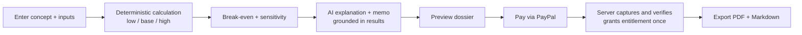

# 01 — Executive Summary

Owner of: vision and validation framing. Requirements live in [02](02-product-scope-and-requirements.md); decisions in [18](18-architecture-decision-records.md).

## 1. Product vision

Help independent publishers and self-publishing authors decide, *before* spending money, whether a specific title is worth producing, by turning scattered assumptions into a transparent, reproducible, evidence-labelled financial case.

## 2. Problem statement

Title-level go/no-go decisions in small-scale publishing are commonly made with ad-hoc spreadsheets, gut feel, and unlabelled assumptions. *Assumption — not yet validated:* that this causes costly mistakes and that people would pay to improve it. No customer evidence for this exists in the materials available to this package.

## 3. Target users (hypotheses)

- Independent authors self-publishing nonfiction/fiction. *Assumption — not yet validated.*
- Small imprints and freelance publishing consultants deciding which titles to fund. *Assumption — not yet validated.*

Personas are detailed in doc 02. Which segment is the real buyer is **OPEN** (OQ-002).

## 4. Initial wedge: Title Business Case

One title, one decision: *should I produce this book, and under what conditions does it pay back?* The wedge is deliberately narrow: no demand scoring, no data licences, no tracking after launch.

## 5. Value proposition (hypothesis)

1. **Trustworthy numbers:** deterministic, reproducible, rule-versioned economics.
2. **Honest uncertainty:** inputs, official facts, estimates, assumptions are labelled; missing evidence is stated.
3. **A shareable artefact:** a dossier (PDF + Markdown) with an AI-drafted memo grounded strictly in calculated results.

## 6. Core workflow

Whether preview is free and export is paid, or the reverse, is **OPEN** (OQ-004). The default assumed throughout: calculation and preview are free (rate-limited); full export is gated by entitlement.

## 7. Business model hypotheses

All of the following are **hypotheses to test, not facts**:

| ID | Hypothesis | Proposed test |
|---|---|---|
| H-1 | Users will pay a one-time fee per dossier | Pricing experiment at $39, $59, $99 |
| H-2 | A concierge-delivered dossier proves value before automation | Manually produce dossiers for a few real titles |
| H-3 | Users need title-level cases repeatedly (not once) | Track repeat intent in interviews |
| H-4 | Willingness to pay exists at all | Customer interviews + willingness-to-pay tests |
| H-5 | Agency/team features, subscriptions, or broader publishing workflows are wanted | **No evidence either way.** Excluded from the MVP; revival needs new evidence and an ADR (doc 01 §12, doc 02 §6) |

Subscription billing is explicitly excluded from the MVP. Price points are configuration, not constants (doc 06 `price_points`).

## 8. Validation status

- Verdict: **VALIDATE FURTHER.** Not validated product-market fit.
- No customer interviews, trials, purchase commitments, or willingness-to-pay results are known to this package.
- The research register and validation report were **not available** during authoring or the 0.3.0 correction pass (doc 00 §6).
- Architectural implication: build the smallest thing that can run H-1…H-4, keep the engine and rules reusable, and avoid irreversible infrastructure commitments.
- What is validated and what is hypothesis, topic by topic, is listed in the evidence register (§12.1). Conflicts with earlier owner-stated plans are in §12.2.

## 9. MVP boundaries

In: title business case, structured inputs, deterministic engine, scenarios, break-even, sensitivity, evidence/assumption tracking, versioned rule packs, AI explanation and memo, PDF/Markdown export, PayPal checkout, verified webhooks, server-side entitlements.

Out (no silent entry): market-demand scoring, licensed market data, keyword research/clustering, KDP report import (pending legal review), actual-sales tracking, research-to-results tracking, project management, agency/team features, subscriptions, enterprise multi-tenancy. Full list and amendment process in doc 02 §6.

## 10. Major architectural decisions (all Proposed unless stated)

| ADR | Decision | Status |
|---|---|---|
| ADR-001 | Modular monolith, single deployable web app | Proposed |
| ADR-002 | TypeScript end-to-end, pnpm workspace | Proposed |
| ADR-003 | PostgreSQL as system of record | Proposed |
| ADR-004 | Pure, I/O-free calculation engine package | Proposed |
| ADR-005 | Money as integer minor units; rounding policy defined per Rule Pack | Proposed |
| ADR-006 | Versioned Rule Packs stored immutably | Proposed |
| ADR-007 | AI behind a provider-agnostic interface; numbers injected and verified, never generated | Proposed |
| ADR-008 | Payment proof only via verified PayPal webhooks (plus reconciliation) | **Superseded** by ADR-019 and ADR-020 |
| ADR-009 | Synchronous request path first; DB-backed job table only if needed | Proposed |
| ADR-019 | Webhooks: persist the verified event, process in a separate atomic transaction with explicit `processing_status`, lease, retry and terminal states (never "duplicate id = done") | Proposed |
| ADR-020 | One canonical PayPal capture: an authenticated, owner-only server endpoint (EP-023) is the only capture initiator; one `settleCapture` for three server-side evidence sources | Proposed |
| ADR-021 | Data lifecycle: two-phase deletion, tombstoned user row, content purge, minimised retained payment records, `RESTRICT`/`SET NULL` foreign keys | Proposed |
| ADR-022 | Evidence governance: source-conflict rules and validation-gated scope | Proposed |

The stack is **not established in any repository** available to this package; these are recommendations.

## 11. Known uncertainties

- Whether the product is wanted and at what price (H-1…H-4).
- Authoritative, current marketplace royalty and print-cost rules: must be sourced from official documents and dated; none are asserted here (OQ-006).
- Hosting, auth provider, PDF renderer, AI provider: OPEN (doc 18).
- Legal: terms of service, tax handling, privacy law applicability: no legal assessment exists (doc 11, doc 19).
- Whether prior work exists that this package should reconcile with (doc 00 §6, doc 01 §12).
- How long payment, audit and event records must be retained, and whether pseudonymous ids count as personal data: no legal assessment exists (doc 06 §8.4, RISK-025, RISK-036).
- PayPal facts not verifiable from the documentation pages read (approved-order validity window, webhook payload field locations, verification response values): doc 08 §0.

## 12. Source reconciliation register (Correction A)

**Inspected:** the research register, market-validation report, decisions register, ADRs, `AGENTS.md`, `docs/DESIGN.md`, product documents and git history **do not exist in the workspace** (whole-filesystem searches on 2026-11-03 and 2026-11-04; the workspace is not a git repository). The only additional inputs are earlier **owner statements** about the predecessor concept "Kindle Intelligence" (renamed Nimphy, 2026-11-02). They are recorded below as *owner-stated planning inputs*: they are not verified documents and nothing here depends on them being accurate beyond what the owner confirms.

### 12.1 Evidence register — validated facts vs hypotheses

| Topic | Status in this package | Basis |
|---|---|---|
| Title Business Case as the initial wedge | Adopted as **scope decision**, not a validated market fact | Task brief |
| Verdict "VALIDATE FURTHER" | Recorded as the validation status; **not** product-market fit | Task brief (the report itself was unavailable) |
| Customer interviews, product trials, purchase commitments, willingness-to-pay results | **None known; none claimed** | Task brief ("no established …") |
| One-time dossier prices $39, $59, $99 | **Hypotheses / experiments**; prices are configuration (FR-019) | Task brief |
| Concierge delivery before full automation | **Proposed** validation approach (H-2, OQ-008); billing automation is deferrable behind it (doc 17) | Task brief |
| Demand for agency/team features | **No evidence.** Excluded | Task brief; the predecessor "Agency" tier was only a pricing hypothesis |
| Demand for subscriptions | **No evidence.** Excluded (one-time purchase only) | Task brief; owner approval 2026-11-01 (hackathon scope) |
| Demand for broader publishing workflows (project management, sales tracking, research-to-results) | **No evidence.** Excluded | Task brief |
| KDP sales-report import | **Legal status unresolved**; excluded until a legal review (RISK-027) | Task brief |
| Market size, revenue, traction | **None asserted anywhere** in this package | — |

### 12.2 Conflicts found and the governing source

| ID | Conflict | Governs | Resolution |
|---|---|---|---|
| R-1 | **Pricing model.** Predecessor planning hypothesised monthly subscription tiers (free / $15 / $39 / $99; author / pro / agency) with PayPal subscriptions. The current brief, and the owner's approval of 2026-11-01 for the hackathon, are a one-time premium dossier purchase with no subscriptions or credits. | Current brief and owner approval | Subscription billing and any agency tier remain excluded (doc 02 §6). The earlier tiers are superseded *hypotheses* with no demand evidence. |
| R-2 | **Scope.** Predecessor planning included free research tools as an acquisition layer (royalty and profitability calculators, idea validator, keyword clustering), reader-demand gap intelligence and a research memory. | Current brief (explicit exclusions) | All excluded from the MVP. Continuity retained: deterministic royalty/break-even engine, evidence/provenance ledger, "AI cannot alter the numbers", source-rights awareness (as Rule Pack source references). A free stand-alone calculator would need its own ADR. |
| R-3 | **Stack and infrastructure.** Predecessor planning named Next.js/React/TypeScript/Tailwind v4/shadcn-ui, a Node modular monolith, PostgreSQL with Drizzle and row-level security, AWS and GitHub Actions. No file establishes any stack. | No file; owner confirmation | ADR-001/002/003 already agree. Hosting (ADR-010), row-level security (ADR-014), migration tool (ADR-015), UI kit (doc 10) stay **OPEN** with the predecessor choice recorded as the *carry-over candidate*; confirming the carry-overs resolves them cheaply. Nothing is marked Accepted on the owner's behalf. |
| R-4 | **Document set and timing.** Predecessor planning asked for a 24-document suite (00–23) and, on 2026-11-02, not to write the engineering suite or code before validation. The current brief asks for 23 documents (00–22) now, architecture only. | Current brief | 23 documents. The validation caution is respected: implementation stays gated on approval, and the optional concierge gate (OQ-008) precedes billing automation (doc 17). |
| R-5 | **Licence.** The owner approved Apache-2.0 for the hackathon repository (2026-11-01, before the rename). | Owner statement; applies to Nimphy only if confirmed | OQ-013; a `LICENSE` file belongs in STEP-001 if confirmed. |
| R-6 | **Payment scope.** "PayPal one-time premium dossier purchase" in the hackathon plan agrees with the current brief. | Consistent | None. |
| R-7 | **Validation report unverifiable.** Any statement in the real report that contradicts this package must be raised at approval. | Report (for market facts) | OQ-001. |

Decisions arising from this register: ADR-022 (Proposed). No revenue, traction, customer or market-size figure from any source is reproduced here; aspirational targets stated in earlier planning are deliberately not carried into the architecture.
