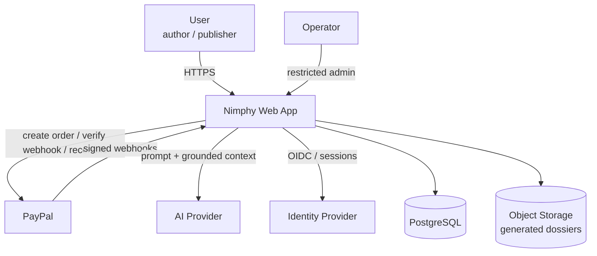
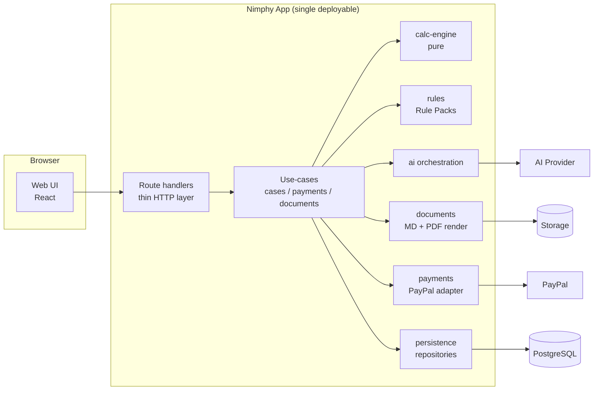
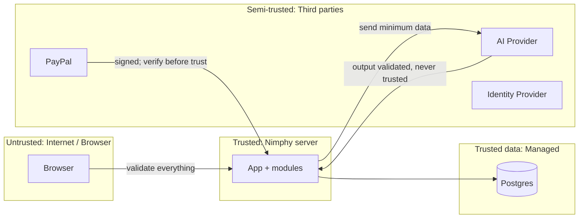
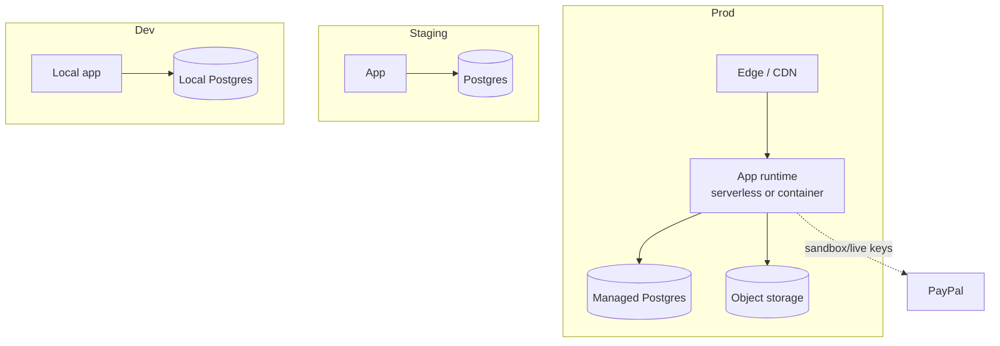

# 04 — System Architecture

Related: [03](03-architecture-principles.md), [05](05-component-responsibilities.md), [08](08-event-schema-and-payment-lifecycle.md), [13](13-deployment-and-infrastructure.md). Technology names below are **Proposed** (ADR-001…003, 010–014), not established.

## 1. High-level architecture

A **modular monolith**: one deployable web application (UI + HTTP API) backed by one PostgreSQL database, with pure internal packages for domain logic, calculation, rules, AI orchestration, documents, and payments. External services: PayPal, one AI provider, an identity provider, object storage (optional), error/log tooling.

No microservices (ADR-001). No message broker at MVP (ADR-009).

## 2. System context

## 3. Container-level architecture

## 4. Component interactions (summary)

| Flow | Path |
|---|---|
| Save inputs | UI → handler → `cases.saveRevision` → validate → `persistence` |
| Calculate | UI → handler → `cases.runCalculation` → load revision + Rule Pack → `calc-engine` → store run |
| Explain | `cases.generateMemo` → build grounded context from run + evidence → `ai` → validate output → store memo |
| Dossier | `documents.assemble(run, memo)` → render MD/PDF → store file + hash |
| Checkout | `payments.createOrder`: insert `orders(CREATED)` → PayPal create order → store `paypal_order_id`, `APPROVAL_PENDING` → return approval URL |
| Approval | Browser → PayPal hosted page → redirect to return URL (informational only) |
| Capture | Return page → `POST /orders/{id}/capture` (EP-023) → `payments.captureOrder`: server reads PayPal, compare-and-set `CAPTURE_REQUESTED`, the **only** PayPal capture call |
| Payment proof | Three server-side, authenticated evidence sources feed one `settleCapture`: (S1) our capture response, (S2) a signature-verified webhook processed through the persisted inbox, (S3) our own authenticated read from PayPal; entitlement is granted in the same transaction that sets `COMPLETED` |
| Deletion | `lifecycle.requestCaseDeletion` / `requestAccountDeletion` → phase 1 (hide) → purge sweeper (doc 06 §8) |
| Export | handler → entitlement check → stream stored file |

## 5. Trust boundaries

Rules: (1) browser input is hostile; (2) PayPal webhook is hostile until signature verification succeeds; (3) AI output is untrusted until validated against the run; (4) the client redirect after PayPal approval carries no authority, and neither does any browser-supplied "success" (INV-13); the browser may only *ask the server* to capture, and the server decides from its own reads (doc 08).

## 6. External systems

| System | Purpose | Failure effect |
|---|---|---|
| PayPal (Orders + Webhooks + verification API) | Checkout, payment proof | Cannot purchase; existing entitlements unaffected |
| AI provider | Explanation, memo | Numbers still shown; memo unavailable |
| Identity provider | Sign-in | No new sessions |
| Object storage | Generated dossier files (or regenerate on demand — **OPEN**, ADR-013) | Export falls back to regeneration |
| Error tracking / logs | Operations | Reduced visibility |

## 7. Data flows

Sensitive flows: (a) user inputs and evidence → DB; (b) calculated results + minimal evidence text → AI provider (see doc 09 §9 for what is sent); (c) payment metadata ↔ PayPal (no card data ever touches Nimphy); (d) dossier files → user.

## 8. Runtime architecture

- Stateless request handlers; all state in Postgres/storage.
- Calculation runs synchronously in-request (pure, fast).
- Memo generation: synchronous-with-streaming-or-polling at MVP; if latency or timeouts require, move to a DB-backed `jobs` row processed by a scheduled/triggered handler (ADR-009, **Proposed**, trigger in doc 15).
- Webhook handler: verify signature → persist the verified event (`RECEIVED`) → process in a separate atomic transaction that also records the outcome; failures are recorded and retried by a scheduled sweeper independent of PayPal's own retries (doc 08 §5). Reconciliation reads PayPal directly and never captures.
- Scheduled invocations (sweeper, reconciliation/expiry, deletion purge) run through the host's scheduler (ADR-009); none is an always-on worker.

## 9. Deployment topology (proposed)

Environments: local, preview/staging (PayPal **sandbox**), production (PayPal **live**, enabled only after doc 22 release gates). Host choice is **OPEN** (ADR-010).
