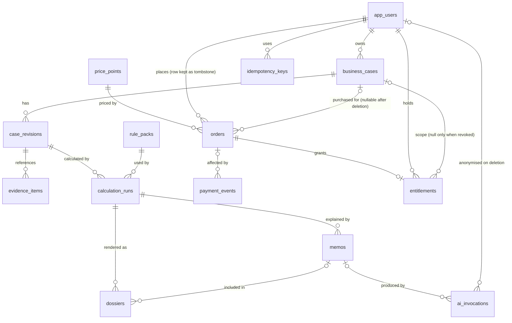
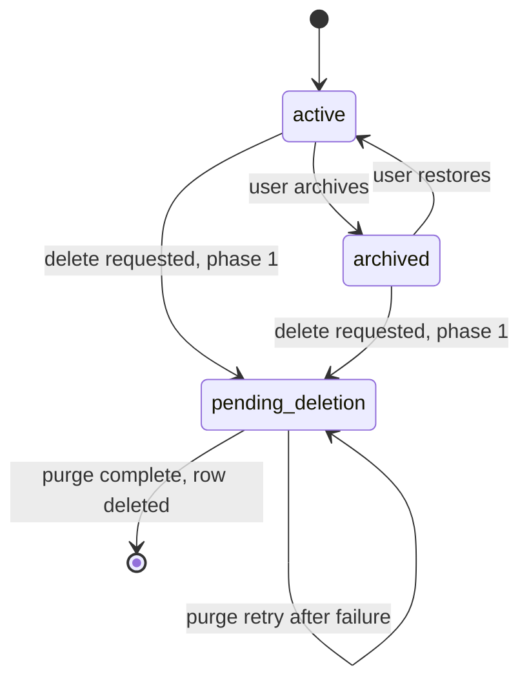
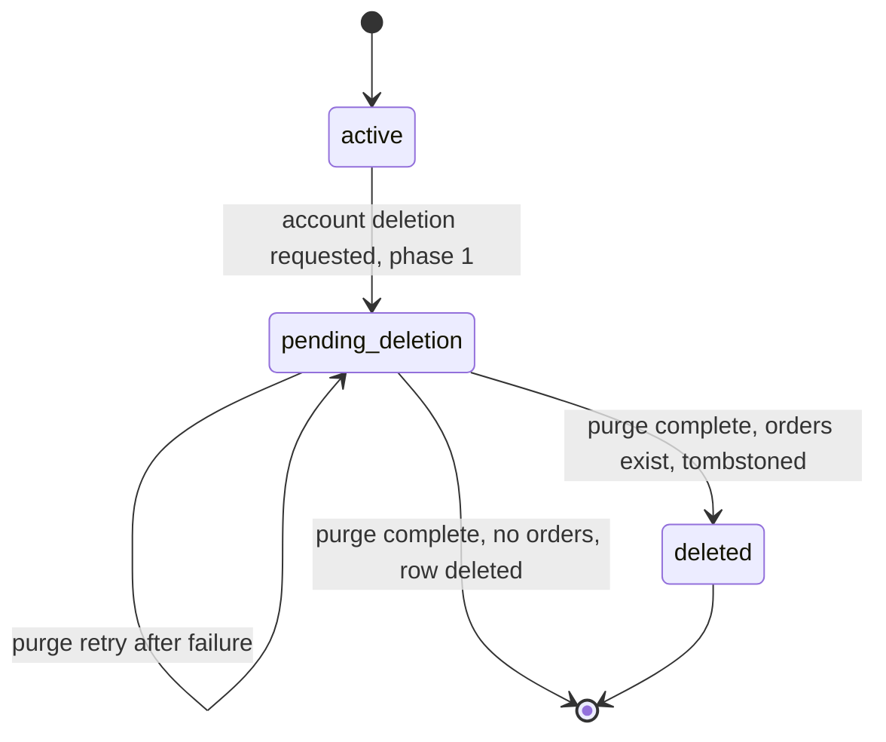

# 06 — Database Architecture and Schema

Related: [05](05-component-responsibilities.md), [08](08-event-schema-and-payment-lifecycle.md) (owns payment/event state vocabulary), [11](11-security-and-privacy-architecture.md), [18](18-architecture-decision-records.md) (ADR-019, ADR-021). All DDL is **design-level**; it has not been executed against a database.

**Revision note (0.2.0):** deletion semantics were redesigned (two-phase deletion, tombstoned user, nullable/`SET NULL` financial links) because 0.1.0 combined "cascade delete" with non-null foreign keys from `orders`/`entitlements`, which would either block deletion or destroy payment records. Webhook event rows gained an explicit processing status (ADR-019). `CAPTURED` was removed from order statuses.

**Review note (0.3.0):** the 0.2.0 text of this document was found on disk at the start of the 0.3.0 pass (author not recorded) and was reviewed, not rewritten. Changes: the global lock order that doc 08 refers to is now actually defined (§7); `payment_events.summary` must include the payee (merchant) id because settlement validates it; deletion of a paid case or account requires explicit acknowledgement (`ERR-LIFE-002`); redaction of `raw_body` waits for final event status; `CAPTURE_REQUESTED` can now leave via the read-only expiry path (doc 08 §6), so deletion refusal (`ERR-LIFE-001`) is bounded in time.

## 1. Choice and rationale

**PostgreSQL** (ADR-003, Proposed): relational integrity for money and entitlements, unique and partial unique constraints for idempotency, `jsonb` for versioned snapshots, row locks and `SKIP LOCKED` for safe concurrent processing, transactional DDL (NFR-013). Host is **OPEN** (ADR-010).

Conventions: `uuid` PKs (`gen_random_uuid()`); `timestamptz` UTC; money as `bigint` minor units plus `char(3)` currency; enums as `text` + `CHECK`; deletion is explicit and two-phase (§8), not an incidental side effect of `ON DELETE CASCADE`.

## 2. Entity relationships



`audit_log` has **no foreign keys** (it stores ids only, by design); it is omitted from the diagram.

## 3. Tables and ownership

| Table | Owner module | Purpose | Deletable by user flow? |
|---|---|---|---|
| `app_users` | auth / lifecycle | Local profile keyed to IdP subject; becomes a tombstone | Tombstoned or removed (§8.2) |
| `business_cases` | cases | A user's title case | Purged (§8.1) |
| `case_revisions` | cases | **Immutable** input snapshot | Cascade with case |
| `evidence_items` | cases | Evidence/notes with provenance | Cascade |
| `rule_packs` | rules | **Immutable** versioned rules | Never |
| `calculation_runs` | cases | **Immutable** engine output + trace | Cascade |
| `memos` | cases/ai | AI-drafted memo bound to one run | Cascade |
| `ai_invocations` | ai | Content-free cost/latency telemetry | Anonymised, retained |
| `dossiers` | documents | Rendered artefact metadata (+ hash, storage key) | Cascade + file deletion |
| `price_points` | payments | Configurable price | Never |
| `orders` | payments | Purchase state machine (doc 08 §6) | **Retained** (minimised) |
| `payment_events` | payments | Verified PayPal notifications inbox | **Retained** (redacted) |
| `entitlements` | payments | Right to export a case's dossier | **Retained** (revoked) |
| `idempotency_keys` | web | Replay protection | Purged by TTL/user purge |
| `audit_log` | ops | Append-only ids-and-codes log | Retained per retention (OPEN) |

No table was added for deletion tracking: `status`, `deletion_requested_at`, `purge_attempts`, `purge_last_error` columns on `app_users` and `business_cases` carry the two-phase workflow (§8).

## 4. Table definitions (design-level DDL)

```sql
create table app_users (
  id uuid primary key default gen_random_uuid(),
  idp_subject text,                       -- null once tombstoned
  email text,                             -- OPEN: store or delegate to IdP; null once tombstoned
  status text not null default 'active'
    check (status in ('active','pending_deletion','deleted')),
  created_at timestamptz not null default now(),
  deletion_requested_at timestamptz,
  deleted_at timestamptz,
  purge_attempts int not null default 0,
  purge_last_error text,
  check (status <> 'deleted' or (idp_subject is null and email is null and deleted_at is not null))
);
create unique index app_users_idp_subject_uq on app_users (idp_subject) where idp_subject is not null;
create index on app_users (deletion_requested_at) where status = 'pending_deletion';

create table business_cases (
  id uuid primary key default gen_random_uuid(),
  user_id uuid not null references app_users(id) on delete cascade,   -- safety net only; see §8
  title text not null check (char_length(title) between 1 and 200),
  status text not null default 'active'
    check (status in ('active','archived','pending_deletion')),
  created_at timestamptz not null default now(),
  updated_at timestamptz not null default now(),
  deletion_requested_at timestamptz,
  purge_attempts int not null default 0,
  purge_last_error text
);
create index on business_cases (user_id, updated_at desc) where status <> 'pending_deletion';
create index on business_cases (deletion_requested_at) where status = 'pending_deletion';

create table case_revisions (
  id uuid primary key default gen_random_uuid(),
  case_id uuid not null references business_cases(id) on delete cascade,
  revision_no int not null check (revision_no > 0),
  inputs jsonb not null,               -- validated against inputs schema vN
  inputs_schema_version int not null,
  inputs_hash text not null,           -- sha256 of canonical JSON
  created_at timestamptz not null default now(),
  unique (case_id, revision_no)
);

create table evidence_items (
  id uuid primary key default gen_random_uuid(),
  revision_id uuid not null references case_revisions(id) on delete cascade,
  field_path text,
  provenance text not null check (provenance in ('user_input','official_fact','estimate','assumption')),
  kind text not null check (kind in ('quote','url','note','document_ref')),
  summary text not null check (char_length(summary) <= 2000),
  source_ref text,                     -- stored text; never fetched server-side
  captured_at date,
  created_at timestamptz not null default now()
);
create index on evidence_items (revision_id);

create table rule_packs (
  id uuid primary key default gen_random_uuid(),
  pack_key text not null,
  version text not null,               -- semver
  effective_from date not null,
  effective_to date,
  content jsonb not null,
  content_hash text not null,
  source_ref text not null,            -- official document reference
  source_retrieved_at date not null,
  status text not null check (status in ('draft','published','retired')),
  created_at timestamptz not null default now(),
  unique (pack_key, version),
  check (effective_to is null or effective_to > effective_from)
);
-- Published rows immutable: trigger rejects UPDATE of content/hash when status <> 'draft'.

create table calculation_runs (
  id uuid primary key default gen_random_uuid(),
  revision_id uuid not null references case_revisions(id) on delete cascade,
  rule_pack_id uuid not null references rule_packs(id),
  engine_version text not null,
  scenario_params jsonb not null,
  results jsonb not null,
  trace jsonb not null,
  results_hash text not null,
  created_at timestamptz not null default now(),
  unique (revision_id, rule_pack_id, engine_version, results_hash)
);
create index on calculation_runs (revision_id, created_at desc);

create table memos (
  id uuid primary key default gen_random_uuid(),
  run_id uuid not null references calculation_runs(id) on delete cascade,
  content jsonb not null,
  prompt_version text not null,
  model_id text not null,
  validation_status text not null check (validation_status in ('passed','failed')),
  created_at timestamptz not null default now()
);
create index on memos (run_id, created_at desc);

create table ai_invocations (          -- content-free telemetry: no prompts, no completions
  id uuid primary key default gen_random_uuid(),
  memo_id uuid references memos(id) on delete set null,
  user_id uuid references app_users(id) on delete set null,   -- anonymised when the user row is removed
  model_id text not null,
  prompt_version text not null,
  input_tokens int, output_tokens int,
  cost_micros bigint,
  latency_ms int,
  outcome text not null check (outcome in ('ok','rejected','error','budget_blocked')),
  created_at timestamptz not null default now()
);

create table dossiers (
  id uuid primary key default gen_random_uuid(),
  run_id uuid not null references calculation_runs(id) on delete cascade,
  memo_id uuid references memos(id) on delete set null,
  format text not null check (format in ('markdown','pdf')),
  content_hash text not null,
  storage_key text,                    -- null if regenerated on demand (OPEN, ADR-013)
  created_at timestamptz not null default now()
);

create table price_points (
  id uuid primary key default gen_random_uuid(),
  code text not null unique,
  amount_minor bigint not null check (amount_minor > 0),
  currency char(3) not null,
  active boolean not null default false,
  created_at timestamptz not null default now()
);

create table orders (
  id uuid primary key default gen_random_uuid(),
  user_id uuid not null references app_users(id) on delete restrict,       -- tombstone row keeps this valid
  case_id uuid references business_cases(id) on delete set null,           -- null after case deletion
  price_point_id uuid not null references price_points(id),
  amount_minor bigint not null check (amount_minor > 0),                   -- snapshot at order time
  currency char(3) not null,
  status text not null default 'CREATED' check (status in
    ('CREATED','APPROVAL_PENDING','APPROVED','CAPTURE_REQUESTED','COMPLETED',
     'FAILED','EXPIRED','REFUNDED','REVERSED')),
  paypal_order_id text unique,
  paypal_capture_id text unique,
  capture_status text,                  -- PayPal's reported capture status (e.g. PENDING, COMPLETED)
  capture_requested_at timestamptz,
  expires_at timestamptz,               -- approval/capture TTL
  review_flag text,                     -- e.g. AMOUNT_MISMATCH, UNEXPECTED_CAPTURE
  created_at timestamptz not null default now(),
  updated_at timestamptz not null default now()
);
create index on orders (user_id, created_at desc);
create index on orders (status, updated_at) where status in ('CAPTURE_REQUESTED','APPROVAL_PENDING','APPROVED');
-- one open order per case (duplicate-click guard; null case_id rows are never "open"):
create unique index orders_one_open_per_case on orders (case_id)
  where status in ('CREATED','APPROVAL_PENDING','APPROVED','CAPTURE_REQUESTED');

create table payment_events (
  id uuid primary key default gen_random_uuid(),
  paypal_event_id text not null unique,               -- identity of the notification
  event_type text not null,
  order_id uuid references orders(id) on delete restrict,   -- resolved from custom_id; null if unknown
  summary jsonb not null,                              -- allow-listed projection: ids, type, amount, currency, capture status, payee (merchant) id. No names/emails. Processing reads only this, never raw_body.
  raw_body jsonb,                                      -- redactable; null after redaction
  raw_body_redacted_at timestamptz,
  processing_status text not null default 'RECEIVED' check (processing_status in
    ('RECEIVED','FAILED_RETRYABLE','PROCESSED','IGNORED','REJECTED','FAILED_TERMINAL')),
  outcome_reason text,                                 -- e.g. ALREADY_APPLIED, UNKNOWN_ORDER, AMOUNT_MISMATCH
  attempt_count int not null default 0,
  next_retry_at timestamptz,                           -- doubles as the processing lease
  last_error_code text,
  last_error_at timestamptz,
  received_at timestamptz not null default now(),
  processed_at timestamptz,
  check ((processing_status in ('PROCESSED','IGNORED','REJECTED')) = (processed_at is not null))
);
create index payment_events_due on payment_events (next_retry_at, received_at)
  where processing_status in ('RECEIVED','FAILED_RETRYABLE');
create index on payment_events (order_id);
create index on payment_events (processing_status) where processing_status in ('FAILED_TERMINAL','REJECTED');
-- Only signature-verified events are ever inserted; unverified requests are not stored.

create table entitlements (
  id uuid primary key default gen_random_uuid(),
  user_id uuid not null references app_users(id) on delete restrict,
  case_id uuid references business_cases(id) on delete set null,
  order_id uuid not null unique references orders(id) on delete restrict,
  scope text not null check (scope in ('dossier_export')),
  status text not null check (status in ('active','revoked')),
  revoke_reason text check (revoke_reason in ('refund','reversal','case_deleted','account_deleted','operator')),
  granted_at timestamptz not null default now(),
  revoked_at timestamptz,
  check ((status = 'revoked') = (revoked_at is not null)),
  check (status = 'revoked' or case_id is not null)    -- an active entitlement always has its case
);
create index on entitlements (user_id, case_id) where status = 'active';

create table idempotency_keys (
  key text not null,
  user_id uuid not null references app_users(id) on delete cascade,
  endpoint text not null, request_hash text not null,
  response_status int, response_body jsonb,
  created_at timestamptz not null default now(),
  primary key (user_id, endpoint, key)
);

create table audit_log (               -- no foreign keys; ids and codes only, never PII
  id bigint generated always as identity primary key,
  at timestamptz not null default now(),
  actor_user_id uuid,
  actor_kind text not null check (actor_kind in ('user','system','operator','webhook')),
  action text not null, entity_type text, entity_id text,
  correlation_id text, details jsonb     -- written only through an allow-list mapper
);
create index on audit_log (entity_type, entity_id);
```

Entitlement scope (per case vs per revision vs regeneration rights) remains **OPEN** (OQ-003, ADR-018); per-case is the default encoded above.

## 5. Constraints worth stating explicitly

| Guarantee | Mechanism |
|---|---|
| One notification identity | `payment_events.paypal_event_id` unique (identity only — **not** proof that processing succeeded; processing is judged by `processing_status`, doc 08 §5.3) |
| At most one entitlement per order | `entitlements.order_id` unique + `insert … on conflict do nothing` |
| One PayPal order / capture per local order | unique `paypal_order_id`, `paypal_capture_id` |
| One open order per case | partial unique index `orders_one_open_per_case` |
| No active entitlement without a case | `CHECK (status='revoked' or case_id is not null)` — forces phase-1 revocation before a case row can be purged |
| Tombstone integrity | `CHECK` on `app_users` for `deleted` rows |
| Payment records survive deletions | `ON DELETE RESTRICT` from `orders.user_id`, `entitlements.user_id/order_id`, `payment_events.order_id`; `SET NULL` for case links |
| Immutability | triggers or revoked privileges: no UPDATE/DELETE by the application role on `case_revisions`, `calculation_runs`, published `rule_packs`, `audit_log`; `payment_events` may only change processing/redaction columns; DELETE of `case_revisions`/`calculation_runs` is permitted **only** through the purge path (the purge role/function), tested in migrations |
| Row-level security as a second line of defence | **OPEN** (ADR-014); application ownership predicates are mandatory regardless |

## 6. Foreign-key behaviour (complete list)

| FK | On delete | Reason |
|---|---|---|
| `business_cases.user_id → app_users` | `CASCADE` | Safety net for users with no retained records; normal path purges cases explicitly first (storage cleanup) |
| `case_revisions.case_id`, `evidence_items.revision_id`, `calculation_runs.revision_id`, `memos.run_id`, `dossiers.run_id` | `CASCADE` | User content disappears with its case |
| `calculation_runs.rule_pack_id` | `NO ACTION` | Rule packs are never deleted |
| `dossiers.memo_id`, `ai_invocations.memo_id` | `SET NULL` | Avoid ordering problems and keep telemetry |
| `ai_invocations.user_id` | `SET NULL` | Telemetry becomes anonymous when the user row is removed |
| `orders.user_id`, `entitlements.user_id` | `RESTRICT` | Financial rows must keep a valid owner — the tombstone user row |
| `orders.case_id`, `entitlements.case_id` | `SET NULL` | Case content may be purged without erasing the financial record |
| `entitlements.order_id`, `payment_events.order_id` | `RESTRICT` | Orders are retained |
| `idempotency_keys.user_id` | `CASCADE` | No retention value |

## 7. Transaction boundaries

| Operation | Transaction scope |
|---|---|
| Save revision | insert revision + evidence + audit (one tx) |
| Run calculation | read inputs → engine (outside tx) → insert run + audit (one tx) |
| Create order | Tx A: insert `orders(CREATED)` → **PayPal call outside any DB tx** → Tx B: store `paypal_order_id`, `APPROVAL_PENDING` (or `FAILED`) |
| Capture (EP-023) | Tx C: lock order, validate, CAS to `CAPTURE_REQUESTED` → PayPal capture call outside tx → Tx D: `settleCapture` (order state + capture id + entitlement + audit, atomically) |
| Webhook intake | verify signature (outside tx) → Tx P: persist event + first lease → Tx X: lock event, lock order, apply, set event status (atomic) → on failure Tx F: record `FAILED_RETRYABLE` |
| Sweeper | per event: claim (short tx) → Tx X |
| Case deletion | phase 1 tx (hide, revoke, expire) → purge: delete files, then one `DELETE business_cases` tx (§8.1) |
| Account deletion | phase 1 tx → purge steps, each idempotent (§8.2) |

PayPal and object-storage calls are never made inside a database transaction.

**Global lock order (deadlock avoidance; owned here, applied by doc 08):** every transaction that touches more than one of these row types acquires locks in the order **`business_cases` → `orders` → `payment_events`** (then `entitlements`, which is only reached through its order). Rules:
- Order creation (Tx A), capture CAS (Tx C), settlement (Tx D / Tx X) and the expiry job first take `FOR SHARE` on the order's case row when `orders.case_id` is not null (creation additionally requires `business_cases.status = 'active'`), then `FOR UPDATE` on the order row, and re-read `orders.case_id`; if it changed meanwhile (case purged) they restart once.
- Case deletion phase 1 takes `FOR UPDATE` on the case row, then on that case's orders; phase 2's `DELETE FROM business_cases` acquires the case lock first, so its `SET NULL` updates on `orders`/`entitlements` follow the same order.
- The webhook claim and Tx F touch only the event row and take no other locks, so they cannot participate in a cycle.
- Lock waits use a bounded `lock_timeout`; a timeout is a retryable failure (doc 08 §5.5), never a partial update.

## 8. Data lifecycle and deletion (Correction C)

### 8.1 Options considered

| Option | Verdict |
|---|---|
| Hard-delete everything with `CASCADE` | Destroys payment records and any chance of dispute handling; or is blocked by non-null FKs. Rejected. |
| Soft delete only (`deleted_at`) | Leaves personal content and PII in place indefinitely. Rejected for content; used only transiently (phase 1). |
| Anonymise orders in place, drop user row | Requires nullable `user_id` everywhere and loses a stable owner key for reconciliation. Rejected. |
| **Two-phase deletion + tombstoned user + content purge + minimised retained financial records (chosen, ADR-021)** | Content is erased; financial/audit facts are kept in minimal, PII-free form; every FK stays valid. |

### 8.2 Deletion semantics (answers to the eleven questions)

| # | Question | Behaviour |
|---|---|---|
| 1 | User deletes a business case | **Phase 1 (one tx, immediate):** `status='pending_deletion'` (the case disappears from every API and query: 404); active entitlements → `revoked` (`case_deleted`); unpaid open orders (`CREATED/APPROVAL_PENDING/APPROVED`) → `EXPIRED`; audit. **Rejected with `409 ERR-LIFE-001`** if any order for the case is `CAPTURE_REQUESTED` (payment in flight; the refusal clears when the order settles, or at the latest when it expires at `expires_at` + grace, doc 08 §6). **Rejected with `409 ERR-LIFE-002`** if an active entitlement exists (paid access would be lost) unless the request carries the explicit acknowledgement `acknowledgePaidLoss=true`; deletion implies no refund. **Phase 2 (purge, idempotent):** delete stored dossier files (if ADR-013 stores files), then one `DELETE FROM business_cases` that cascades revisions, evidence, runs, memos, dossiers; `orders.case_id` and `entitlements.case_id` become null. Failures set `purge_last_error`, increment `purge_attempts`, and are retried by the sweeper. |
| 2 | User deletes their account | **Phase 1 (one tx):** `app_users.status='pending_deletion'`; sessions revoked (IdP/session adapter); every case → `pending_deletion` (as above); active entitlements → `revoked` (`account_deleted`); unpaid open orders → `EXPIRED`; audit. **Rejected with `409 ERR-LIFE-001`** if any order is `CAPTURE_REQUESTED`, and with `409 ERR-LIFE-002` if any active entitlement exists unless `acknowledgePaidLoss=true` is sent. Requires recent authentication (OPEN). **Phase 2 (purge, idempotent steps):** purge all cases (as above); delete `idempotency_keys`; redact PII in this user's `payment_events.raw_body` (§8.3); delete the IdP identity via adapter (ADR-011); then **if the user has no `orders`** delete the `app_users` row; **otherwise tombstone it** (`status='deleted'`, `email=null`, `idp_subject=null`, `deleted_at=now()`). |
| 3 | Orders | Retained. Contain no personal content: ids, amount, currency, status, PayPal order/capture ids, timestamps, flags. `case_id` null if the case was purged; `user_id` points to the tombstone. |
| 4 | Payment records (`payment_events`) | Retained as the verified notification inbox. `summary` (allow-listed, PII-free) stays. `raw_body` is redacted (set to null, `raw_body_redacted_at` set) at account deletion and, for non-deleted users, after a retention window that **requires legal review** (OPEN). Redaction applies only to events whose `processing_status` is final (`PROCESSED`, `IGNORED`, `REJECTED`, `FAILED_TERMINAL`): processing reads only `summary`, so redaction cannot break a retry, but diagnostic material is kept until the event is final. The account purge step therefore retries until none of the user's events is non-final (bounded by the retry budget, doc 08 §5.7). Until that decision, the redaction-by-age job is disabled; this package asserts **no** retention period. |
| 5 | Entitlements | Retained but `revoked` with a reason. No refund is implied by deletion (policy OPEN, doc 02 OQ-007). The UI warns before deletion that paid export access is lost. |
| 6 | Generated dossiers | `dossiers` rows cascade with the case; stored files are deleted in phase 2 before the row delete (so the storage key is still known). If files are regenerated on demand (ADR-013 alternative), nothing is stored. Copies the user already downloaded cannot be recalled. |
| 7 | AI-related records | `memos` cascade with the case. `ai_invocations` hold **no content** (tokens, cost, latency, outcome, ids): `memo_id` → null and, when the user row is removed, `user_id` → null; they remain as anonymous cost telemetry. If the user row is only tombstoned, `user_id` still points at the tombstone (no PII). Data already sent to the AI provider is governed by the provider's retention terms (legal review, RISK-020); zero-retention options are to be checked, not assumed. Application logs must not contain prompts/completions (doc 09 §9). |
| 8 | Audit records | `audit_log` is append-only, has no FKs, and holds only ids and action codes written through an allow-list mapper — no emails, titles, free text or payloads. It is retained for a window **requiring legal review** (OPEN). `actor_user_id` is a random UUID; whether such pseudonymous ids count as personal data is a legal question (RISK-036). |
| 9 | PII removal | Removed or nulled: `app_users.email`, `idp_subject`; all case content (titles, inputs, evidence, memos, dossiers) via purge; payer data in `raw_body`; IdP identity; idempotency keys. By construction not stored: card data, payer names/emails in `summary`, prompts. Logs: structured, ids only, short retention set at the host (verify). |
| 10 | Foreign keys stay valid | Financial FKs are `RESTRICT` to a user row that is **kept** as a tombstone; case links are `SET NULL`; only content tables cascade. The `CHECK (status='revoked' or case_id is not null)` on entitlements makes it impossible to purge a case that still has an active entitlement. |
| 11 | Backups | Deleted data remains in provider backups until those backups expire (retention window is host-specific — verify; not asserted here). Therefore: (a) the privacy notice must state this honestly (legal text OPEN); (b) a **deletion ledger** — subject type, id, completion time, **no PII** — is written outside the primary database at purge completion (mechanism OPEN: operator-held export or separate log sink); (c) any restore runbook **must replay the ledger** before the restored database serves traffic, so deleted users/cases do not reappear. Restore without ledger replay is a defect. |

### 8.3 Deletion state machines





`pending_deletion` rows older than a threshold (proposal: 1 hour for cases, 24 hours for accounts) raise an alert. The purge is resumable: every step tolerates already-completed work.

### 8.4 Retention summary (all periods OPEN, legal review required)

| Data | Behaviour | Period |
|---|---|---|
| Cases, revisions, runs, memos, dossiers | Deleted by user action or account deletion | until user deletes |
| Orders, entitlements, tombstone user | Retained minimised after deletion | **OPEN — requires legal/tax review** |
| `payment_events.summary` | Retained with orders | **OPEN** |
| `payment_events.raw_body` | Redacted at account deletion; age-based redaction disabled until decided | **OPEN** |
| `audit_log` | Retained | **OPEN** |
| `ai_invocations` | Anonymous telemetry retained | **OPEN** (aggregate-only is an option) |
| `idempotency_keys` | TTL 24–72 h | proposal |
| Backups | Provider-defined; ledger replay on restore | verify |

No legal compliance is claimed. Until periods are decided, the safe default is to keep only the minimised records above and to run no age-based deletion on them.

## 9. Versioning

- `inputs_schema_version` on revisions; old revisions never rewritten.
- `rule_packs.version` semver; runs reference `rule_pack_id`.
- `engine_version` on runs (git SHA or semver — OPEN).
- Reproducibility: identical (revision, rule pack, params, engine version) ⇒ identical `results_hash` (NFR-001, NFR-014).

## 10. Migration strategy

Forward-only numbered SQL migrations (tool OPEN, ADR-015), applied in CI to an empty database and to the previous schema; expand/contract for destructive changes; no data migration without tested rollback or backup point. Seeds for Rule Packs and `price_points` are explicit operator scripts. Migration tests must cover: immutability triggers, the entitlement `CHECK`, `RESTRICT`/`SET NULL` behaviour on deletion paths, `payment_events` claim queries (`SKIP LOCKED`), and the lock-order and concurrency scenarios in doc 08 §10.

## 11. Audit requirements

Record: sign-in events (if available), case/account deletion phases, order creation and every order transition, webhook intake outcome and event-status changes, operator requeues, entitlement grant/revoke, rule pack publish, export download, admin actions. Never store secrets, card data, PII, payloads or prompts.
