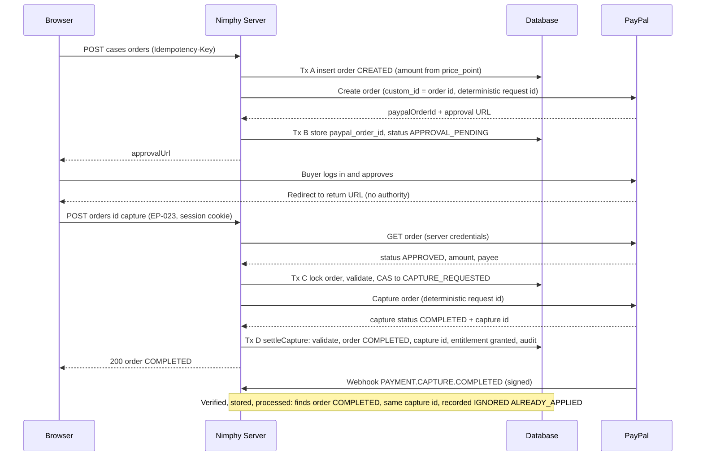
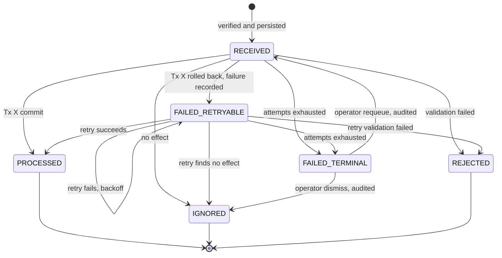
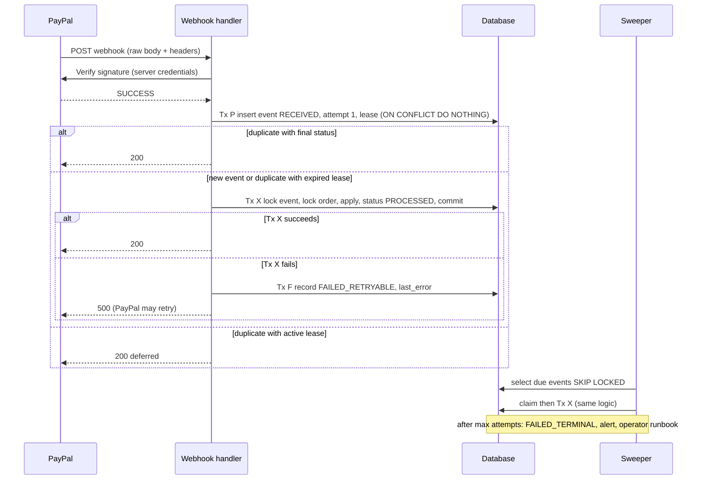
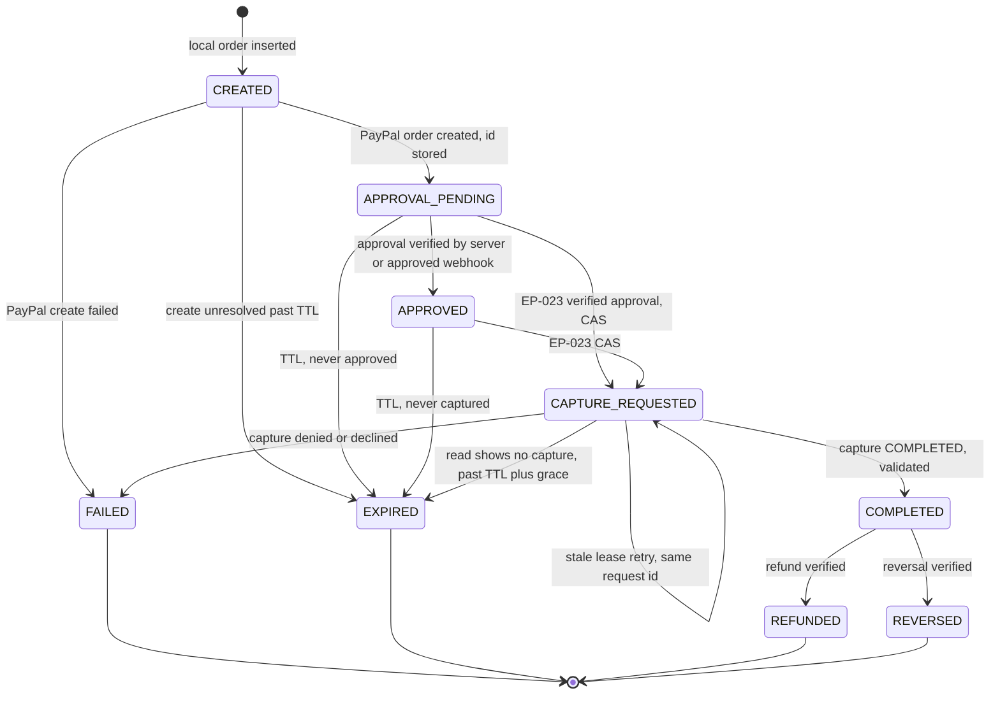

# 08 — Event Schema and Payment Lifecycle

Related: [06](06-database-architecture-and-schema.md) (`orders`, `payment_events`, `entitlements`, lock order), [07](07-api-architecture.md), [11](11-security-and-privacy-architecture.md), [18](18-architecture-decision-records.md) (ADR-019 webhook inbox, ADR-020 canonical capture, ADR-021 data lifecycle; ADR-008 superseded), [12](12-testing-and-ai-evaluation.md) §7.

**Payment verification is a backend security boundary (INV-13).** A browser redirect or any browser-supplied value proves nothing. Payment facts are accepted only from three server-side, authenticated evidence sources (§4): our own capture call, a signature-verified webhook, or our own authenticated read from PayPal.

PayPal API behaviour was partly verified against developer.paypal.com on 2026-11-04 (see §0). Anything marked *unverified* there must be confirmed against live sandbox traffic and current PayPal documentation at STEP-025 to STEP-027 (doc 17) before implementation relies on it.

**Revision note (0.2.0):** this document replaces the 0.1.0 design, which (a) treated a duplicate `paypal_event_id` as already processed even if processing had failed, (b) left the capture trigger OPEN, and (c) used inconsistent state names (`CAPTURED`, `processing_outcome`). See ADR-019 and ADR-020.

**Provenance and 0.3.0 review note:** the 0.2.0 text of this document (and of doc 06) was found already on disk at the start of the 0.3.0 correction pass; its author and review history are not recorded anywhere inspected, and it carried a note claiming that ADR-019/020/021, EP-023, ERR-PAY-005 and ERR-LIFE-001 were defined elsewhere, which was **false at the time** (docs 07 and 18 had not been updated). It was therefore reviewed line by line and kept, not rewritten. Defects found and fixed in 0.3.0:

1. `PayPal-Request-Id` values of the form `nimphy-capture-<uuid>` (about 51 characters) exceed PayPal's documented 38-character limit; replaced by deterministic UUIDv5 values (§3.2).
2. `CAPTURE_REQUESTED` had no exit when the buyer never returned after a crash, which would block new orders and any deletion for that case indefinitely; added the read-only `CAPTURE_REQUESTED → EXPIRED` path (§3.4, §6, §8).
3. Unmappable `PAYMENT.CAPTURE.*` events were `IGNORED` (`UNKNOWN_ORDER`), which could silently drop a valid payment; they now retry and then fail terminally with an alert (§5.3).
4. `PAYMENT.CAPTURE.DECLINED` (Payments v2) was missing (§5.8).
5. Lock ordering was attributed to doc 06 §7 but not defined there; now defined in doc 06 §7 and applied to every order-touching transaction.
6. Request-id retention at PayPal is undocumented, so no design step may rely on it alone (§3.2 Q7).
7. Persist failure behaviour (`503`), a consolidated failure/retry matrix (§5.12), operator dismissal of terminal events (§5.5, §5.10), and a database-changes summary (§11) were missing.
8. The dangling references above are now defined: ADR-019/020/021/022 in doc 18, EP-023, ERR-PAY-004/005 and ERR-LIFE-001/002 in doc 07.

## 0. PayPal API facts and verification status

| Fact used by this design | Status (checked 2026-11-04 against developer.paypal.com) |
|---|---|
| Capture is `POST /v2/checkout/orders/{id}/capture`; the buyer must have approved the order first; optional `PayPal-Request-Id` and `Prefer` headers; Bearer authentication | **Verified** (Orders v2 capture page) |
| Repeating a request with the same `PayPal-Request-Id` returns the latest status of the earlier request instead of re-processing; the header is limited to 38 single-byte characters (UUID recommended); two simultaneous requests with one id: the first is processed, the second may fail; omitting the header duplicates the request | **Verified** (idempotency guideline page) |
| How long PayPal stores a request id | **Not stated** ⇒ never relied on alone (§3.2 Q7) |
| Server flow recommended by PayPal: server creates order; buyer redirected to approval URL; after return, server calls capture; `Show order details` can be called at any stage | **Verified** (Orders API integration page) |
| Webhook verification: `POST /v1/notifications/verify-webhook-signature` with `transmission_id`, `transmission_time`, `cert_url`, `auth_algo`, `transmission_sig`, `webhook_id`, `webhook_event`; the event must be posted back exactly as received; incoming headers `paypal-transmission-id`, `paypal-transmission-time`, `paypal-cert-url`, `paypal-transmission-sig`; self-verification (CRC32 plus signature) is the alternative; postback verification is not supported for simulator mock events | **Verified** (webhooks integration page) |
| Name and values of the verification response field (`verification_status`, `SUCCESS`) | **Unverified** (the pages read show only the request) |
| Event names `CHECKOUT.ORDER.APPROVED`, `CHECKOUT.PAYMENT-APPROVAL.REVERSED`, `PAYMENT.CAPTURE.COMPLETED`, `.PENDING`, `.DECLINED` (Payments v2), `.DENIED` (Payments v1), `.REFUNDED`, `.REVERSED` | **Verified** (event names page) |
| Delivery: any non-2xx is a failed delivery; up to 25 retries over 3 days; then marked Failed and resendable manually | **Verified** (webhooks page) |
| How long an approved but uncaptured order stays capturable, and what PayPal does with it | **Not stated** ⇒ the 3-hour order TTL is an *Assumption — not yet validated*, enforced by us and checked by reads |
| Where our own reference (`custom_id` / `reference_id`) and the PayPal order id appear in each webhook resource | **Unverified** ⇒ mapping has fallbacks and an alerting path (§5.3); fixtures from real sandbox events are mandatory at STEP-027 |
| Exact error identifier for "order already captured" | **Unverified** ⇒ detect by re-reading the order, never by matching an error string |
| Token endpoint and API host per environment | Sandbox token URL seen on the capture page; live host not checked ⇒ base URL is configuration (`PAYPAL_ENV`), verified at STEP-025 |

## 1. State vocabulary (single owner of these names)

| Object | Statuses | Owner of definition |
|---|---|---|
| Order (`orders.status`) | `CREATED`, `APPROVAL_PENDING`, `APPROVED`, `CAPTURE_REQUESTED`, `COMPLETED`, `FAILED`, `EXPIRED`, `REFUNDED`, `REVERSED` | §6 |
| Payment event (`payment_events.processing_status`) | `RECEIVED`, `FAILED_RETRYABLE`, `PROCESSED`, `IGNORED`, `REJECTED`, `FAILED_TERMINAL` | §5.5 |
| Entitlement (`entitlements.status`) | `active`, `revoked` (+ `revoke_reason`) | §7 |

No other document may introduce additional values. `CAPTURED` no longer exists.

## 2. Domain events

In-process, synchronous publication at MVP (no broker). Money-relevant events are written to `audit_log`; PayPal notifications are stored in `payment_events`.

**Naming:** `<context>.<entity>.<past-tense-action>.v<N>`, lower-case.

| Event | Emitted by | Payload (v1) |
|---|---|---|
| `cases.revision.saved.v1` | cases | `caseId, revisionId, revisionNo, inputsHash, userId` |
| `cases.run.completed.v1` | cases | `runId, revisionId, rulePackId, engineVersion, resultsHash` |
| `cases.deletion.requested.v1` / `.completed.v1` | lifecycle | `caseId, userId` / `caseId` |
| `accounts.deletion.requested.v1` / `.completed.v1` | lifecycle | `userId` / `userId` |
| `ai.memo.generated.v1` | ai | `memoId, runId, promptVersion, modelId, validation` |
| `ai.memo.rejected.v1` | ai | `runId, promptVersion, reasonCode` |
| `documents.dossier.rendered.v1` | documents | `dossierId, runId, format, contentHash` |
| `payments.order.created.v1` | payments | `orderId, caseId, userId, amountMinor, currency, paypalOrderId` |
| `payments.order.approved.v1` | payments | `orderId, paypalOrderId` |
| `payments.capture.requested.v1` | payments | `orderId, paypalOrderId` |
| `payments.capture.completed.v1` | payments | `orderId, captureId, amountMinor, currency, evidenceSource` (`capture_response` \| `webhook` \| `reconciliation`) |
| `payments.capture.failed.v1` | payments | `orderId, reasonCode` |
| `payments.capture.refunded.v1` / `.reversed.v1` | payments | `orderId, captureId, amountMinor` |
| `payments.entitlement.granted.v1` | payments | `entitlementId, orderId, caseId, userId` |
| `payments.entitlement.revoked.v1` | payments | `entitlementId, orderId, reason` |
| `payments.webhook.signature_rejected.v1` | payments | `reasonCode, receivedAt` (no body stored) |
| `payments.event.failed_terminal.v1` | payments | `eventId, paypalEventId, lastErrorCode, attempts` |
| `payments.event.requeued.v1` / `payments.event.dismissed.v1` | payments (operator action) | `eventId, paypalEventId, operatorId, reason` |
| `payments.order.review_flagged.v1` | payments | `orderId, flag` (e.g. `AMOUNT_MISMATCH`, `UNEXPECTED_CAPTURE`) |
| `payments.order.expired.v1` | payments | `orderId, fromStatus, evidenceSource` |
| `dossier.export.downloaded.v1` | web | `dossierId, userId, format` |

**Envelope:** `{ eventId, name, version, occurredAt, correlationId, actor, payload }`. **Versioning:** additive fields keep the version; removal or meaning change creates `.v2`; consumers ignore unknown fields; stored audit rows keep the version they were written with.

## 3. Canonical checkout and capture flow (Correction D)

### 3.1 Options evaluated

| Option | How capture starts | Assessment |
|---|---|---|
| O1. Return handler captures (server-side, on the user's return) | Browser lands on return URL → server captures | Simple, immediate UX. Risks: user who approves then closes the tab never captures; if a webhook also captures, double capture. Acceptable **only** if it is the sole capture path. |
| O2. Webhook captures on `CHECKOUT.ORDER.APPROVED` | Verified approval webhook triggers capture | Works if the browser vanishes. Cons: capture timing depends on webhook delivery; capture becomes a side-effect of notification processing (retries, duplicates, out-of-order); harder to give the user a synchronous answer. |
| O3. **Explicit authenticated capture endpoint called by the frontend after approval; webhooks and reconciliation never initiate capture** | One backend operation, `POST /api/v1/orders/{orderId}/capture` (EP-023), invoked by the logged-in user's browser after PayPal redirects back | Single initiator, user-bound, synchronous result, easy to make idempotent with a compare-and-set. Cost: an approved-but-never-captured order (tab closed) simply expires with no money taken. |
| O4. Auto-capture on approval via PayPal-side configuration | PayPal captures without a server call | Removes the capture step but weakens our control point and may depend on integration type; not adopted without verifying PayPal support. |

**Decision (ADR-020, Proposed): O3.** The *only* code path that calls PayPal's capture operation is the `captureOrder` use-case behind EP-023. The return page is a UI shell that calls EP-023; the redirect parameters carry no authority (the server uses its own stored `paypal_order_id`, not a value from the URL). The webhook handler and the reconciliation job **cannot** call `captureOrder`; this is enforced by module structure (the `PayPalPort.captureOrder` method is imported by one use-case only) and by a test (§10).

Trade-off accepted: a buyer who approves at PayPal and closes the browser is not charged and must start a new order. Alternatives that capture later (O2, or a sweeper that captures abandoned approved orders) were rejected because they charge a buyer who is no longer present and enlarge the double-capture surface.

### 3.2 Answers to the twelve required questions

| # | Question | Answer |
|---|---|---|
| 1 | Who creates the PayPal order? | The Nimphy server, in `createOrder` behind EP-016, using server-held credentials. The browser never supplies an amount. |
| 2 | How are the local order and PayPal order ID stored? | Tx A inserts `orders(status=CREATED)` with amount/currency snapshotted from the active `price_point`, **before** calling PayPal. Tx A also takes `FOR SHARE` on the case row and requires `status = 'active'` (a case being deleted can never receive a new order; lock order in doc 06 §7). The PayPal create call carries `reference_id` and `custom_id` = local order id and a deterministic idempotency key: `PayPal-Request-Id` = UUIDv5(Nimphy namespace, `create:` + local order id). PayPal limits the header to 38 single-byte characters and recommends UUIDs (§0), so prefixed forms such as `nimphy-create-<uuid>` are invalid. On success, Tx B stores `paypal_order_id` and sets `APPROVAL_PENDING`. |
| 3 | How does the frontend obtain approval? | EP-016 returns the PayPal approval URL (from the create response). The browser redirects to it. (A JS-SDK button flow is possible; it would still call EP-016 and EP-023 identically — **OPEN** UI detail, doc 10.) |
| 4 | How does the user approve? | On PayPal's hosted pages, by logging in and consenting. PayPal then redirects to our return URL (`/checkout/return?orderId=<local id>`; PayPal also appends its own token, which we ignore). |
| 5 | Exactly which backend operation triggers capture? | `POST /api/v1/orders/{orderId}/capture` (EP-023), authenticated, owner-only, `Idempotency-Key` supported. It is the sole initiator. |
| 6 | How does the server authenticate with PayPal? | OAuth2 client-credentials: client id/secret (server-only env) exchanged for a short-lived access token, cached in memory until shortly before expiry and refreshed on 401. Base URL (sandbox vs live) comes from `PAYPAL_ENV`. Tokens are never logged. |
| 7 | How are duplicate capture attempts prevented? | Five layers: (1) compare-and-set under order row lock — only one request moves `APPROVAL_PENDING/APPROVED → CAPTURE_REQUESTED`; (2) deterministic `PayPal-Request-Id` = UUIDv5(Nimphy namespace, `capture:` + local order id), so a repeated call within PayPal's (undocumented) retention window returns the original result instead of capturing again; because that window is not documented, every retry after an ambiguous outcome starts with a read (`resolveCapture`) and a new capture call is issued only when PayPal reports the order approved and uncaptured; (3) PayPal itself refuses to capture an already-captured order (treated as "resolve", not as an error; detected by re-reading the order because the exact error identifier is unverified, §0); (4) unique `paypal_order_id` / `paypal_capture_id`; (5) no other module may call capture (§3.1). |
| 8 | How are capture timeouts and ambiguous responses resolved? | See §3.4. The order stays `CAPTURE_REQUESTED`; resolution is a *read* of PayPal's authoritative state (`resolveCapture`), never a blind second capture with a new key. |
| 9 | How are capture IDs persisted? | In the settlement transaction (§4): `orders.paypal_capture_id` and `orders.capture_status` (PayPal's reported status) are written together with the state change; unique constraint on capture id. |
| 10 | How do verified webhooks reconcile with capture results? | Both feed the same `settleCapture` function (§4). Whichever arrives first transitions the order; the other finds the order already `COMPLETED` with the same capture id and is recorded `IGNORED` (`ALREADY_APPLIED`). A different capture id for the same order is `REJECTED` and flagged. |
| 11 | How does the local order reach its final state? | `CAPTURE_REQUESTED → COMPLETED` (or `FAILED`) via `settleCapture`; later `COMPLETED → REFUNDED/REVERSED` via verified events. Orders that never get approval/capture reach `EXPIRED`/`FAILED` by TTL or definitive failure. |
| 12 | Exactly when is an entitlement granted? | Inside the same database transaction that moves the order to `COMPLETED`, after validation of amount, currency, payee and capture status, via `insert … on conflict (order_id) do nothing`. Never before. Never from a redirect. |

### 3.3 Sequence — creation, approval, capture, entitlement



### 3.4 Capture failure and ambiguity cases

| Case | Behaviour |
|---|---|
| EP-023 called when PayPal says order not yet approved | No state change; `ERR-PAY-005` (409) "approval not completed". |
| EP-023 called twice concurrently | Row lock + CAS: one winner calls PayPal; the loser sees `CAPTURE_REQUESTED`, performs a read-only `resolveCapture`, and returns current status (`202` if still unresolved). |
| Capture call times out / connection reset / 5xx | State stays `CAPTURE_REQUESTED`. Up to 2 immediate retries of the **same** call (same request id). If still unknown: return `202 {"status":"CAPTURE_REQUESTED"}`; the UI shows "confirming payment". |
| PayPal returns "order already captured" | Treated as resolve: fetch order, find capture, `settleCapture`. |
| Capture response `COMPLETED` | `settleCapture` → `COMPLETED` + entitlement. |
| Capture response `PENDING` | Remains `CAPTURE_REQUESTED`, `capture_status='PENDING'`; no entitlement; final result arrives via webhook or reconciliation. |
| Definitive decline/denial | `FAILED` (no retry on the same order); user starts a new order. Trade-off: simpler than reopening funding choice on the same order. |
| Server crashes after PayPal captured but before Tx D | Order is `CAPTURE_REQUESTED`; webhook (`PAYMENT.CAPTURE.COMPLETED`) or the reconciliation job (frequent for `CAPTURE_REQUESTED` older than ~1 min, interval OPEN) settles it. No money is lost or unattributed. |
| Server crashes after Tx C, before calling PayPal | Order is `CAPTURE_REQUESTED`, PayPal not captured. `resolveCapture` reads PayPal: order `APPROVED` and uncaptured ⇒ no capture happened; the order is **not** re-captured automatically; it is returned to `APPROVED` only by an explicit EP-023 call from the user (which re-enters through the CAS from `CAPTURE_REQUESTED` when `capture_requested_at` is older than a lease of N seconds and PayPal confirms no capture exists). Stale-lease re-entry is the only permitted `CAPTURE_REQUESTED → CAPTURE_REQUESTED` re-attempt, and uses the same request id. If the buyer never returns, the order would stay `CAPTURE_REQUESTED` indefinitely (blocking new orders for the case and any deletion). Fix (0.3.0): once `expires_at` plus a grace period (proposal: 30 minutes, configurable, longer than any capture call) has passed and a read shows PayPal has **no** capture for the order, the reconciler moves it `CAPTURE_REQUESTED → EXPIRED` using read-only S3 evidence (§8). A capture that lands later is `REJECTED` as `UNEXPECTED_CAPTURE` with an operator alert, never granted. |
| Amount/currency/payee mismatch in capture result | No entitlement; order flagged (`review_flag`), event `REJECTED`, operator alert (money may have moved: manual refund decision). |
| Buyer approved at PayPal, then closed the tab (no EP-023 call) | Nothing is captured and the buyer is not charged. While the order is within its TTL and `APPROVAL_PENDING/APPROVED`, the dossier page shows "Complete payment", which calls EP-023 for the **same** order (the buyer is present, so a user-initiated capture remains the only initiator). After TTL the order expires and the buyer starts a new one. Conversion loss from this trade-off is RISK-037. |
| User deletes the case or account while an order is `CAPTURE_REQUESTED` | Deletion is refused with `ERR-LIFE-001` until the order settles (§7; doc 06 §8.2). |

## 4. The single settlement function

`settleCapture(orderId, evidence)` is the only place an order becomes `COMPLETED`, `FAILED`, `REFUNDED` or `REVERSED`, and the only place entitlements are granted or revoked. It is called by exactly three evidence sources:

| Source | Evidence | Trust basis |
|---|---|---|
| S1 `capture_response` | Result of our authenticated capture call (EP-023) | Server-to-server TLS call with our credentials |
| S2 `webhook` | Event that passed signature verification (§5.1) | PayPal signature verified by PayPal's API |
| S3 `reconciliation` | Our authenticated `GET` of the order/capture from PayPal | Server-to-server TLS call with our credentials |

None of these is browser-supplied. Algorithm (single transaction):

1. `select … from orders where id = $1 for update`.
2. Map and validate: PayPal order id matches the stored one; amount and currency equal the order snapshot; payee/merchant matches configuration; capture status as claimed.
3. Evaluate the transition table (§6) against the **current** status. If already at or past the target with the same capture id ⇒ no-op result `ALREADY_APPLIED`. If it contradicts (different capture id, impossible regression) ⇒ `REJECTED`.
4. Apply the transition; write `paypal_capture_id`, `capture_status`, `updated_at`.
5. On `COMPLETED`: `insert into entitlements … on conflict (order_id) do nothing`.
6. On `REFUNDED`/`REVERSED`: set the entitlement to `revoked` (`revoke_reason = 'refund' | 'reversal'`) per OQ-007 policy (default proposal: revoke; OPEN).
7. Write `audit_log`. Commit.

Because steps 3–5 run under the order row lock and the entitlement has a unique `order_id`, an entitlement cannot be granted twice even if S1, S2 and S3 all fire concurrently.

## 5. Webhook intake and processing (Correction B)

### 5.1 Verification (before anything is stored)

1. Enforce a maximum body size; read the **raw body** (do not re-serialise).
2. Extract PayPal transmission headers (transmission id, time, signature, certificate URL, auth algorithm).
3. Call PayPal's webhook-signature verification API (`POST /v1/notifications/verify-webhook-signature`, §0) with our configured webhook id, the four `paypal-transmission-*`/`paypal-cert-url` header values, the auth algorithm and the event posted back **exactly as received**; require a success result (the response field name and values were not shown on the pages read and must be confirmed at STEP-027). Reject certificate URLs not on PayPal's hosts (no SSRF). Offline self-verification (CRC32 plus certificate signature) is an alternative (**OPEN**); the API call is the proposed default and is not available for simulator mock events (use self-verification or recorded real sandbox events in tests).
4. Parse and schema-validate only after verification succeeds.

Unverifiable events are **never persisted**: invalid signature ⇒ `400`, a counter metric and an `audit_log` row without the body. Verification service unavailable ⇒ `503` so PayPal retries (we never assume validity).

### 5.2 Why persist-then-process (options and trade-offs)

| Option | Description | Verdict |
|---|---|---|
| A. Single atomic transaction | Insert event + apply payment change + commit; on any error roll back **both**, return 5xx | Correct and simple: a failed attempt leaves no row, so PayPal's retry is processed fresh. Weaknesses: failures are invisible to us (no record, no attempt counts, no stuck-event query); recovery depends entirely on PayPal's finite retry window and on reconciliation; poison events cannot be quarantined. |
| B. **Inbox: persist verified event, then process in a separate atomic transaction that also records the outcome (chosen)** | Event row has an explicit `processing_status`; the payment change and the `PROCESSED` status commit together; failures are recorded in a separate small transaction | Durable record of every verified event; our own retry loop independent of PayPal; visible, monitorable states; safe with duplicates. Cost: one more table state machine and a scheduled sweeper. |
| C. Queue/worker infrastructure | Persist then enqueue to a broker | Same guarantees as B plus infrastructure cost and operations burden; unjustified at MVP (ADR-009). |

**Decision (ADR-019, Proposed): Option B.** The 0.1.0 defect (a duplicate ID short-circuited to success even when the earlier attempt had failed) is eliminated because a duplicate is judged by **`processing_status`**, never by mere existence of the row.

### 5.3 Persistence and duplicate handling

```
Tx P (persist + first lease), one short transaction:
  INSERT INTO payment_events (paypal_event_id, event_type, order_id?, summary, raw_body,
                              processing_status='RECEIVED', attempt_count=1,
                              next_retry_at = now() + backoff(1))
  ON CONFLICT (paypal_event_id) DO NOTHING
  RETURNING id;
```
- Row returned ⇒ new event, this request holds the first lease ⇒ process now.
- No row returned ⇒ duplicate delivery. Read the existing row and decide by status:

| Existing `processing_status` | Action on duplicate delivery | HTTP |
|---|---|---|
| `PROCESSED`, `IGNORED`, `REJECTED` | Nothing to do (outcome final) | 200 |
| `FAILED_TERMINAL` | Nothing automatic; alert already raised | 200 |
| `RECEIVED` or `FAILED_RETRYABLE`, lease expired (`next_retry_at <= now()`) | Attempt a **claim** (below); if claimed, process now | 200 on success, 500 on failure |
| `RECEIVED` or `FAILED_RETRYABLE`, lease active | Another worker or a backoff window owns it; the sweeper guarantees pickup | 200 `{"status":"deferred"}` |

**If Tx P cannot commit** (database unavailable) nothing is stored and the handler returns `503`; PayPal's own retries (25 attempts over 3 days, §0) cover the outage. A `2xx` is returned only after the event row is durably stored (or the delivery is a true duplicate of a stored row).

**Mapping an event to a local order** (done at Tx P when possible, otherwise at processing), in order of precedence: (1) `custom_id` / `reference_id` equal to our local order id (set before PayPal is ever called); (2) the PayPal order id found in the payload matched to `orders.paypal_order_id`; (3) a capture id matched to `orders.paypal_capture_id`. Which payload fields carry these values is **unverified** (§0); STEP-027 must record real sandbox payload fixtures and the mapping is tested against them.

**An event that cannot be mapped is never dropped silently when it could be a payment:**
- `PAYMENT.CAPTURE.*` and `CHECKOUT.PAYMENT-APPROVAL.REVERSED`: status `FAILED_RETRYABLE` (`ORDER_NOT_RESOLVED`) for the retry budget, then `FAILED_TERMINAL` with an alert. The runbook (§5.10) resolves it by reading PayPal; an operator may then `requeue` it or, if it is demonstrably foreign (e.g. another application on a shared sandbox account), `dismiss` it (`FAILED_TERMINAL → IGNORED`, audited).
- `CHECKOUT.ORDER.APPROVED` and other non-money types for an unknown order: `IGNORED` (`UNKNOWN_ORDER`) with a metric, because approval alone grants nothing and S3 reads recover state.

### 5.4 Claiming (lease) and concurrency

```
claim(eventId):
  UPDATE payment_events
     SET attempt_count = attempt_count + 1,
         next_retry_at = now() + backoff(attempt_count + 1),
         processing_status = CASE WHEN attempt_count + 1 > :max_attempts
                                  THEN 'FAILED_TERMINAL' ELSE processing_status END
   WHERE id = :id
     AND processing_status IN ('RECEIVED','FAILED_RETRYABLE')
     AND (next_retry_at IS NULL OR next_retry_at <= now())
  RETURNING attempt_count, processing_status;
```
- The claim **commits before processing**. It acts as a time-bounded lease and also increments `attempt_count`, so a worker that crashes mid-processing still consumes an attempt: poison events cannot loop forever, and no `PROCESSING` status is needed (no zombie "processing" rows).
- Two concurrent deliveries of the same event: only one `UPDATE` matches the lease condition; the other gets no row and returns `deferred`.
- If the claim itself exhausts the retry budget (`FAILED_TERMINAL` returned), the caller does **not** process; it emits `payments.event.failed_terminal.v1` and the alert (§5.10). A terminal transition therefore never happens silently.
- Different events for the same order (e.g., S1 and an S2 event, or approved + completed events) run concurrently; they serialise on the **order row lock** inside Tx X.
- **Global lock order (deadlock avoidance, owned by doc 06 §7):** `case → order → payment_event`. Settlement (S1/S2/S3) first reads the order's `case_id` without locking, takes `FOR SHARE` on that case row when `case_id` is not null, then `FOR UPDATE` on the order row, then re-reads `orders.case_id`; if it changed (case purged meanwhile) it restarts once. Case-deletion phase 1 takes `FOR UPDATE` on the case row, then on the case's orders. Because the claim and Tx F touch only the event row and take no further locks, they cannot form a cycle.

### 5.5 Processing status model

| Status | Meaning | Final? |
|---|---|---|
| `RECEIVED` | Verified and stored; no attempt has finished (first attempt in flight or awaiting sweeper) | No |
| `FAILED_RETRYABLE` | An attempt failed with a retryable error; `next_retry_at` is the next eligible time | No |
| `PROCESSED` | Business effect applied atomically | Yes |
| `IGNORED` | Valid event with no effect (already applied, unsubscribed type, unknown order, stale) — `outcome_reason` explains | Yes |
| `REJECTED` | Verified signature but business validation failed (amount/currency/payee/capture-id mismatch, unexpected capture); order flagged, alert | Yes |
| `FAILED_TERMINAL` | Retry budget exhausted or non-retryable internal error; needs operator action | Yes (operator may `requeue` → `RECEIVED` or `dismiss` → `IGNORED`; both audited) |



Retry error classification: *retryable* — database errors, lock timeouts, PayPal API timeouts during S3 lookup, `ORDER_NOT_RESOLVED`. *Non-retryable* (→ `REJECTED` or `FAILED_TERMINAL` immediately) — schema violations after verification, mismatches, impossible transitions.

### 5.6 Processing transaction (Tx X) and rollback

```
Tx X (one transaction, global lock order case → order → event):
  1. SELECT … FROM business_cases WHERE id=:caseId FOR SHARE     -- only if the order has a case_id
  2. SELECT … FROM orders WHERE id=:orderId FOR UPDATE           -- re-read case_id; restart once if it changed
  3. SELECT … FROM payment_events WHERE id=:id FOR UPDATE        -- re-check status still non-final
  4. settleCapture(...) logic for this event type (§4, §6)       -- order change, entitlement, audit
  5. UPDATE payment_events SET processing_status = 'PROCESSED'|'IGNORED'|'REJECTED',
                               outcome_reason = …, processed_at = now()
  COMMIT
```
- Business change and event status commit **together**. Any exception ⇒ `ROLLBACK`: the order, entitlement and event status all revert; no partial payment state is possible inside the database.
- After a rollback, a separate short transaction Tx F records the failure:
  `UPDATE payment_events SET processing_status='FAILED_RETRYABLE', last_error_code=…, last_error_at=now() WHERE id=:id AND processing_status IN ('RECEIVED','FAILED_RETRYABLE')` (the guard prevents overwriting a final status written by a racing worker). `next_retry_at` was already set by the claim.
- If Tx F also fails (database unavailable) the row remains `RECEIVED` with an expired lease, so the sweeper retries it later. State is never lost.
- Commit succeeded but the HTTP response was lost ⇒ PayPal redelivers ⇒ row is `PROCESSED` ⇒ `200` (true duplicate).

### 5.7 Sweeper (our own retry loop)

A scheduled invocation (mechanism OPEN, doc 15) runs every minute-scale interval:

```
SELECT id FROM payment_events
 WHERE processing_status IN ('RECEIVED','FAILED_RETRYABLE')
   AND next_retry_at <= now()
 ORDER BY received_at
 FOR UPDATE SKIP LOCKED LIMIT :batch;
```
For each id: `claim` (bumps attempt, sets next lease) then Tx X. `FOR UPDATE SKIP LOCKED` lets several overlapping sweeper runs coexist. Backoff and limits (Assumption — not yet validated, configurable): delays 1 min, 5 min, 15 min, 1 h, 3 h, 6 h, 12 h; `max_attempts = 8`.

### 5.8 Event handling by type

| PayPal event | Effect |
|---|---|
| `CHECKOUT.ORDER.APPROVED` | `APPROVAL_PENDING → APPROVED` if currently `APPROVAL_PENDING`; otherwise `IGNORED` (`STALE_OR_ALREADY_APPLIED`). **Never initiates capture.** |
| `PAYMENT.CAPTURE.COMPLETED` | `settleCapture`: allowed from `CAPTURE_REQUESTED`; no-op from `COMPLETED` (same capture id); `REJECTED` + flag (`UNEXPECTED_CAPTURE`) if the order is in `CREATED`, `APPROVAL_PENDING`, `APPROVED`, `EXPIRED` or `FAILED` (a capture Nimphy did not initiate or no longer expects: possible credential misuse, manual capture, or a capture that raced a deletion/expiry; operator review decides on a refund). No entitlement is ever granted on this path. |
| `PAYMENT.CAPTURE.PENDING` | Record `capture_status='PENDING'`; no entitlement |
| `PAYMENT.CAPTURE.DENIED` (Payments v1) and `PAYMENT.CAPTURE.DECLINED` (Payments v2) | `CAPTURE_REQUESTED → FAILED`; for any other order status: `IGNORED` (`STALE_OR_ALREADY_APPLIED`) |
| `PAYMENT.CAPTURE.REFUNDED` | `COMPLETED → REFUNDED`, entitlement `revoked` (policy OPEN) |
| `PAYMENT.CAPTURE.REVERSED` | `COMPLETED → REVERSED`, entitlement `revoked` |
| `CHECKOUT.PAYMENT-APPROVAL.REVERSED` ("a problem occurred after the buyer approved the order but before you captured the payment") | Not subscribed at MVP. If delivered anyway: mapped like capture events (never silently dropped) and handled as a trigger for an S3 read; the read decides (`CAPTURE_REQUESTED`/`APPROVED` orders that PayPal reports as no longer capturable become `FAILED`/`EXPIRED`) |
| any other type | `IGNORED` (`UNSUBSCRIBED_TYPE`) |

Webhook subscriptions are limited to the types above.

### 5.9 Processing sequence



### 5.10 Terminal failures and operator recovery

`FAILED_TERMINAL` raises `payments.event.failed_terminal.v1` and an alert. Runbook (documented in operations notes, doc 13):
1. Inspect `last_error_code` and the stored `summary`.
2. Run `resolveCapture` for the affected order — this reads PayPal's authoritative state, independent of the failed event, and settles correctly even if the event can never be processed.
3. If the cause is fixed (bug, outage), requeue: `FAILED_TERMINAL → RECEIVED` (resets `attempt_count`, clears lease) with an `audit_log` entry by the operator.
4. If the payment is legitimate but cannot be settled automatically, the operator resolves manually and the decision is audited; refunds are decided by a human.

### 5.11 Monitoring (identifying stuck events)

| Signal | Query/definition | Alert (thresholds are proposals) |
|---|---|---|
| Oldest unprocessed event age | `now() - min(received_at)` where status in (`RECEIVED`,`FAILED_RETRYABLE`) | > 10 min |
| Retrying events with high attempts | `FAILED_RETRYABLE` and `attempt_count >= 3` | any |
| Terminal failures | count of `FAILED_TERMINAL` | any (page) |
| Rejected events | count of `REJECTED` | any (review) |
| Orders stuck in capture | `CAPTURE_REQUESTED` older than 10 min | any |
| Approved orders not expiring | `APPROVAL_PENDING/APPROVED` older than TTL | any |
| Invariant: completed without entitlement | `COMPLETED` order with no `active` entitlement (and not later refunded) | any (critical) |
| Invariant: entitlement without completed order | active entitlement whose order is not `COMPLETED` | any (critical) |
| Signature failures | rate of `payments.webhook.signature_rejected.v1` | spike |

The two invariant queries run in the reconciliation job (§8).

### 5.12 Failure and retry scenarios (consolidated)

| # | Scenario | State trail | Outcome |
|---|---|---|---|
| 1 | Tx X fails on first delivery (DB error, lock timeout) | `RECEIVED` → rollback → Tx F → `FAILED_RETRYABLE` (attempt 1) | `500`; order and entitlement unchanged; retried by PayPal or the sweeper; processed once |
| 2 | PayPal redelivers inside the lease window | row `FAILED_RETRYABLE`/`RECEIVED`, lease active | `200 deferred`; the sweeper processes it at `next_retry_at` (a `2xx` stops PayPal retrying, so our sweeper is the retry guarantee) |
| 3 | Redelivery after the lease expired | claim succeeds (attempt +1) | processed inline |
| 4 | Worker crashes after claim, before Tx X | lease expires, status unchanged | sweeper re-claims; the attempt was counted, so poison events cannot loop |
| 5 | Crash after Tx X commit, before the HTTP response | `PROCESSED` | redelivery gets `200`, no effect |
| 6 | N identical deliveries in parallel | one claim wins | others `200 deferred`; one entitlement |
| 7 | S1 (capture response), S2 (webhook) and S3 (read) race on one order | serialise on the order row lock | first applies; others `ALREADY_APPLIED`; one entitlement |
| 8 | Poison event (always fails) | `FAILED_RETRYABLE` ×N → `FAILED_TERMINAL` | alert; runbook §5.10; S3 read settles the payment independently |
| 9 | Valid capture event that cannot be mapped to an order | `FAILED_RETRYABLE` (`ORDER_NOT_RESOLVED`) → `FAILED_TERMINAL` | alert, never `IGNORED`; operator resolves |
| 10 | Amount, currency, payee or capture-id mismatch | `REJECTED`, order `review_flag` | no entitlement; operator decides on a refund |
| 11 | Database unavailable at Tx P | nothing stored | `503`; PayPal retries (25 attempts, 3 days) |
| 12 | Verification API unavailable | nothing stored | `503`; never assume valid |
| 13 | Overlapping sweeper invocations | `SKIP LOCKED` plus claim | no duplicate work |
| 14 | Our retries outlive PayPal's 3-day window | our sweeper is independent of PayPal | processing continues until `max_attempts`; reconciliation reads PayPal directly |
| 15 | Case deletion racing settlement | lock order `case → order → event` (doc 06 §7) | settlement waits for or precedes the purge; `case_id` re-read after locking |

## 6. Order state machine



| From → To | Evidence allowed | Entitlement effect |
|---|---|---|
| `CREATED → APPROVAL_PENDING` | PayPal create response | none |
| `CREATED → FAILED/EXPIRED` | create error / TTL | none |
| `APPROVAL_PENDING → APPROVED` | `CHECKOUT.ORDER.APPROVED` (S2) or server `GET` showing approved | none |
| `APPROVAL_PENDING/APPROVED → CAPTURE_REQUESTED` | EP-023 only, after server `GET` shows approved | none |
| `CAPTURE_REQUESTED → COMPLETED` | S1, S2 or S3, validated | **grant** |
| `CAPTURE_REQUESTED → FAILED` | S1, S2 (`DENIED`), S3 | none |
| `CAPTURE_REQUESTED → CAPTURE_REQUESTED` | EP-023 only, when `capture_requested_at` is older than the lease and S3 shows no capture exists; same request id | none |
| `COMPLETED → REFUNDED/REVERSED` | S2 or S3 | **revoke** (policy OPEN) |
| `APPROVAL_PENDING/APPROVED → EXPIRED` | TTL job | none |
| `CAPTURE_REQUESTED → EXPIRED` | S3 only: PayPal read shows no capture for the order **and** `now > expires_at + grace` | none |
| Any other pair | — | rejected; event `REJECTED` or request `409` |

Order approval TTL default proposal 3 hours (*Assumption — not yet validated*: PayPal's validity window for an approved, uncaptured order was not stated on the pages read, §0; configurable; reads of PayPal's order state take precedence over our TTL). Only one open order per case: partial unique index (doc 06).

## 7. Entitlements

- Granted only in `settleCapture` (§4) when the order becomes `COMPLETED`.
- `entitlements.status ∈ {active, revoked}`; `revoke_reason ∈ {refund, reversal, case_deleted, account_deleted, operator}`.
- Export endpoints check `status = 'active'` for (user, case) on **every** download.
- Refund/reversal: revoke (default proposal, OPEN, OQ-007/ADR-018). Already-downloaded files cannot be recalled (stated in terms, legal text OPEN).
- Case deletion and account deletion revoke entitlements in their phase-1 transaction (doc 06 §8); no refund is implied (policy OPEN). Phase 1 expires unpaid open orders and is **refused** (`ERR-LIFE-001`) while any order is `CAPTURE_REQUESTED`, so deletion can never race an in-flight capture. Settlement of orders whose case was purged (`case_id` null) still works (refund/reversal events only mark the order; the entitlement is already `revoked`).

## 8. Reconciliation

Scheduled job (mechanism OPEN, doc 15):
1. **Capture resolution:** for orders in `CAPTURE_REQUESTED` older than ~1 min, run `resolveCapture` (read-only `GET` from PayPal, then `settleCapture` with S3 evidence).
2. **Expiry:** move `CREATED/APPROVAL_PENDING/APPROVED` past TTL to `EXPIRED`; move `CAPTURE_REQUESTED` past `expires_at` + grace to `EXPIRED` **only** when the PayPal read shows no capture exists (otherwise it settles via step 1). This job **never captures**.
3. **Invariants:** the two critical queries in §5.11; violations alert and are never auto-"fixed" without an audited operator action.
4. **Missed-event recovery:** for `COMPLETED` orders in the last N days, optionally compare against PayPal to catch missed refund/reversal events (window OPEN).

S3 evidence is recorded via `audit_log` (`actor_kind='system'`, `source='reconciliation'`), not as a synthetic `payment_events` row, so the inbox only ever contains PayPal-delivered, signature-verified notifications.

## 9. Audit logging

Every order, event-status and entitlement change writes `audit_log` (`actor_kind ∈ user | system | operator | webhook`) with ids, previous and new state, evidence source, and outcome. No card data is ever received. `payment_events.raw_body` is retained only for a window set after legal review and then redacted; a minimal `summary` projection remains (doc 06 §8). Audit rows contain ids and codes only, never PII.

## 10. Testing requirements (owned jointly with doc 12 §7)

Capture:
- Concurrent double `POST /capture` ⇒ exactly one PayPal capture call (fake port counts calls), one `COMPLETED`, one entitlement.
- Capture timeout then resolve ⇒ no second capture with a different key; settles via S3.
- Capture `PENDING` ⇒ no entitlement until `COMPLETED`.
- Webhook and reconciliation handlers have **no** access to the capture operation (structural test: the port method is referenced by one module).
- Redirect tampering (wrong or foreign order id in URL/body) ⇒ no effect on another user's order; EP-023 is owner-only.
- Approval not completed ⇒ `ERR-PAY-005`.

Webhook processing:
- Forged signature ⇒ 400, no row.
- **Duplicate after failed first attempt** (the 0.1.0 defect): first delivery fails mid-Tx X ⇒ `FAILED_RETRYABLE`, no order change; second delivery (or sweeper) ⇒ `PROCESSED`, entitlement granted once.
- Duplicate after `PROCESSED` ⇒ 200, no change.
- Concurrent duplicate deliveries (N parallel) ⇒ one claim wins; one entitlement.
- Crash simulation between Tx P and Tx X ⇒ sweeper completes; attempt count monotonic.
- Rollback atomicity: injected failure after entitlement insert ⇒ no entitlement, no order change, event not `PROCESSED`.
- Poison event ⇒ `FAILED_TERMINAL` after `max_attempts`; alert emitted; requeue works; operator requeue audited.
- Out-of-order events (`COMPLETED` before `APPROVED`; refund before completion).
- Amount/currency/payee/capture-id mismatch ⇒ `REJECTED`, order flagged, no entitlement.
- Unexpected capture on an `APPROVAL_PENDING` order ⇒ `REJECTED` + flag.
- Oversized and malformed bodies; verification-API outage ⇒ 503 and no row.
- Monitoring queries return seeded stuck cases; invariant queries catch seeded violations.
- Property test: for any interleaving of S1/S2/S3 deliveries and duplicates, at most one active entitlement per order and final state is deterministic.
- `PayPal-Request-Id` values are ≤ 38 characters, deterministic per (call type, order), and different for create and capture.
- A `PAYMENT.CAPTURE.COMPLETED` event that cannot be mapped is never `IGNORED`; it reaches `FAILED_TERMINAL` with an alert; `dismiss` and `requeue` are audited and require operator authority.
- `CAPTURE_REQUESTED` with no PayPal capture past TTL + grace ⇒ `EXPIRED` (read-only); the case can then be deleted and re-ordered; a later capture event is `REJECTED` (`UNEXPECTED_CAPTURE`).
- Persist failure (Tx P) ⇒ `503` and no row; success `2xx` is never returned before the row is durable.
- Lock-order test: concurrent case deletion, order creation, EP-023 and settlement never deadlock and never leave an entitlement for a purged case.
- The checkout kill switch (doc 13) blocks only new orders; it never blocks EP-023, webhook intake, the sweeper or reconciliation.
- Fixtures: real sandbox payloads for every subscribed event type, used to test order mapping (§5.3).

## 11. Database changes required by this design (owner: doc 06)

| Change | Where defined | Why |
|---|---|---|
| `payment_events.processing_status`, `outcome_reason`, `attempt_count`, `next_retry_at` (lease), `last_error_*`, `processed_at`, `summary`, `raw_body` + `raw_body_redacted_at` | doc 06 §4 | Retry-safe inbox; stuck-event queries; redactable PII |
| Partial index `payment_events_due`, index on `processing_status` for terminal/rejected | doc 06 §4 | Sweeper and monitoring |
| `orders.status` set (9 values), `capture_requested_at`, `capture_status`, `expires_at`, `review_flag`, unique `paypal_order_id` / `paypal_capture_id` | doc 06 §4 | Capture lease, expiry, reconciliation, duplicate prevention |
| Partial unique index `orders_one_open_per_case` | doc 06 §4 | One open order per case |
| `entitlements`: unique `order_id`, `revoke_reason`, `CHECK` active ⇒ case present | doc 06 §4–5 | Grant-once; deletion-safe |
| Nullable/`SET NULL` case links, `RESTRICT` user links, tombstoned `app_users` | doc 06 §6, §8 | Deletion without losing payment records |
| Lock order `case → order → payment_event` | doc 06 §7 | Deadlock avoidance |

No other tables are introduced.
