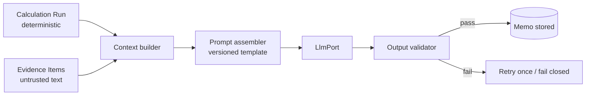

# 09 — AI Architecture

Related: [02](02-product-scope-and-requirements.md) (FR-012), [05](05-component-responsibilities.md) (M-05), [12](12-testing-and-ai-evaluation.md), [11](11-security-and-privacy-architecture.md). Provider and model choice: **OPEN** (ADR-007 covers the abstraction, not the vendor).

## 1. Use cases

| ID | Use case | Output |
|---|---|---|
| AI-UC-1 | Explain calculated results in plain language | Structured explanation sections |
| AI-UC-2 | Draft the Business Case Memo | Structured memo (JSON → rendered) |
| AI-UC-3 | Summarise evidence gaps and uncertainty | List tied to `missingEvidence` and provenance |
| AI-UC-4 | Suggest *questions the user should investigate* | Non-numeric suggestions, labelled as suggestions |

No other AI use is in MVP. AI-assisted input extraction, market-demand estimation, and AI-generated numbers are excluded.

## 2. Allowed / not allowed

| ID | Rule |
|---|---|
| AIR-01 | AI **may** restate numbers that appear verbatim in the supplied run results |
| AIR-02 | AI **may** describe relationships (e.g., "price is the largest sensitivity driver") derived from supplied rankings |
| AIR-03 | AI **may** flag uncertainty, missing evidence, and limitations |
| AIR-04 | AI **must not** produce any monetary value, unit count, percentage, or date not present in the context |
| AIR-05 | AI **must not** recompute, round, convert currency, or "correct" engine output |
| AIR-06 | AI **must not** modify user inputs, or recommend values presented as facts |
| AIR-07 | AI **must not** cite external market data, rates, or sources not supplied as Evidence Items |
| AIR-08 | AI **must not** promise outcomes; language like "will earn", "guaranteed" is rejected |
| AIR-09 | AI **must** label estimates/assumptions as such, using provenance supplied |
| AIR-10 | AI **must** state when evidence is missing |
| AIR-11 | AI output is untrusted until validated (§7) |

## 3. Orchestration boundary



The AI module receives **read-only** run data and cannot call the engine, database, or payments. It returns data only.

## 4. Model abstraction

```
interface LlmPort {
  generateStructured<T>(req: {
    promptVersion: string; system: string; user: string;
    schema: JsonSchema; maxOutputTokens: number; timeoutMs: number;
  }): Promise<{ output: unknown; usage: {inTok:number; outTok:number}; modelId: string }>;
}
```

Adapters per vendor; a fake adapter for tests. Model id and prompt version are stored on each memo (`memos.model_id`, `memos.prompt_version`). Switching models requires re-running the evaluation set (doc 12 §9).

## 5. Prompt architecture

- Prompts are code-reviewed files in the repo (`prompts/` for reusable templates, runtime copies under the `ai` module — location **OPEN**), each with `promptVersion`.
- Structure: (1) system: role, rules AIR-01…AIR-11, output schema; (2) context block of *data*, clearly delimited and described as data not instructions; (3) task.
- User-supplied text (evidence notes, titles) is placed only inside delimited data blocks; the system prompt states that embedded instructions must be ignored (prompt-injection posture, **defence in depth, not a guarantee** — validator is the real control).

## 6. Context construction

Included: scenario results, break-even, ranked sensitivity, rule ref (pack key + version), provenance map, missing-evidence list, disclaimer requirements, and evidence summaries (truncated). Each numeric value is given an **ID token**, e.g. `{{N:base.netContribution}} = 1234.56 USD`. The model is instructed to cite numbers by token; the renderer substitutes the canonical formatted value. This makes AIR-04 mechanically checkable.

Excluded: other users' data, emails/PII, secrets, payment data, raw prompts from earlier runs.

## 7. Structured output and validation

Output JSON schema (sketch):

```
{ "summary": string,
  "sections": [{ "heading": enum, "paragraphs": [{ "text": string, "numberRefs": string[] }] }],
  "uncertainties": string[], "missingEvidenceNotes": string[],
  "questionsToInvestigate": string[], "disclaimerAcknowledged": true }
```

Validation pipeline (all must pass; otherwise `AI_OUTPUT_REJECTED`):
1. JSON-schema validity, length bounds.
2. **Number grounding:** every numeric literal in free text must be (a) an ID token resolvable to the run, or (b) a whitelisted trivial number (e.g., "three scenarios"); all other numerals fail.
3. **Token resolution:** all `numberRefs` exist.
4. **Prohibited-language scan** for guarantees/promises (AIR-08).
5. **Required content:** uncertainties non-empty when any `estimate`/`assumption` provenance exists; missing-evidence notes cover all items in `missingEvidence`.
6. **No external claims:** URLs or named data sources must match supplied Evidence Items.
7. Rendering substitutes canonical values from the run (the model's formatting is never used for money).

On failure: one retry with the validator error summarised; second failure ⇒ fail closed (user sees numbers, no memo, ERR-AI-002).

## 8. Hallucination mitigation (layers)

Grounded context only; numbers by token; validator; low temperature (setting **OPEN**); explicit "unknown" outputs allowed; provenance labels carried through; evaluation set with adversarial cases (§12 of doc 12); human review of the first dossiers delivered (concierge phase).

## 9. Financial-data protection and privacy

- The model never receives authority to change data; it cannot write.
- Data sent: run results and evidence summaries only — no account identifiers, no email.
- Provider data-use/retention terms must be reviewed before use (**OPEN**, legal).
- Logs store token counts, cost, outcome, prompt version — **not** prompt text or completions by default. A debug mode storing prompts is allowed only for synthetic data in non-production environments.
- Deletion: memos are user content and are purged with their case; `ai_invocations` rows hold no content and are retained anonymously (doc 06 §8.2 row 7). Data already sent to the provider is governed by the provider's retention terms, which are **not** under Nimphy's control (RISK-020).

## 10. Deterministic calculation integration

The memo is bound to one `calculation_runs.id` and stores no independent numbers. If the user recalculates, a new run exists and the old memo is shown as tied to the old run; a memo is never reattached to a different run.

## 11. Evaluation framework (summary; owned by doc 12)

Golden evaluation set of synthetic cases with known engine outputs; automatic metrics: grounding pass-rate (target 100% after validation), prohibited-language rate, coverage of missing-evidence notes, uncertainty presence; periodic human rubric scoring; regression gate on prompt or model change.

## 12. Failure handling

| Failure | Behaviour |
|---|---|
| Provider timeout/5xx | Bounded retry with backoff (1 retry); then ERR-AI-001; calculation and preview of numbers remain available |
| Validation failure twice | ERR-AI-002; no memo stored as valid |
| Budget exceeded | ERR-AI-003 |
| Prompt-injection suspected in evidence text | Validator catches output; optionally flag evidence item |

## 13. Cost controls

Per-memo max input/output tokens; per-case regeneration cap; per-user daily cap; memo cached per run (idempotent EP-011); kill-switch config flag; cost recorded in `ai_invocations`. Actual vendor prices are not stated in this package (doc 16).
