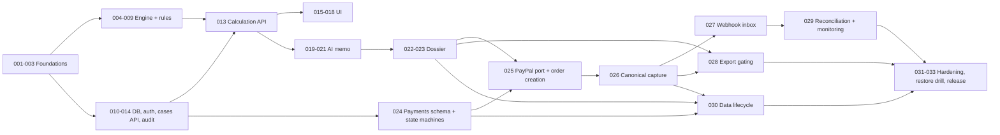

# 17 — Implementation Roadmap

**Governs implementation order.** STEP-001 through STEP-004 have implementations in the repository; formal acceptance and verification status are tracked separately in `docs/DESIGN.md`. Subsequent roadmap steps require explicit repository-owner authorization. The technical roadmap itself remains authoritative. Commands are intended conventions (doc 14) and are verified as each step establishes them.

Related: [02](02-product-scope-and-requirements.md), [12](12-testing-and-ai-evaluation.md), [22](22-definition-of-done.md).

## Rules for every step

- Small enough to implement, test, review, and commit independently (one conventional commit or PR).
- Definition of Done (doc 22) applies; `docs/DESIGN.md` is updated at the end of **every** step.
- A step may not introduce anything on the exclusion list (doc 02 §6).
- If a step exposes an architecture change, update the owning doc and ADR first.

## Phases

| Phase | Goal | Steps |
|---|---|---|
| P0 | Foundations | 001–003 |
| P1 | Deterministic core | 004–009 |
| P2 | Persistence and identity | 010–014 |
| P3 | Product surface (calc flow) | 015–018 |
| P4 | AI memo | 019–021 |
| P5 | Dossier export | 022–023 |
| P6 | Payments | 024–029 |
| P7 | Data lifecycle, hardening and launch gates | 030–033 |

Optional gate before P6 (recommended): run the concierge validation experiment (OQ-008, H-2). P0–P5 are useful even if billing is deferred. **0.3.0 changes:** capture became its own step (026), webhooks moved to 027, export gating 028, reconciliation 029, deletion lifecycle 030 (previously inside hardening), hardening/observability/release became 031–033; `audit_log` moved into STEP-010 and the checkout UI now depends on STEP-022.

## Steps

Each step lists: Objective · Scope · Depends on · Files expected · Acceptance · Tests · Verify · Exit · Docs.

### STEP-001 Project scaffolding
- **Objective:** repo skeleton that builds, lints, tests (one trivial test), and runs.
- **Scope:** pnpm workspace; TypeScript strict; Next.js app shell (empty home page); lint/format; test runner; `AGENTS.md`, `docs/DESIGN.md` (initial), `.env.example`, `.gitattributes`, `.nvmrc`; CI workflow running typecheck/lint/test/build. Resolves ADR-002 details (versions).
- **Depends on:** owner approval of this package.
- **Files:** root configs, `apps/web/**`, `packages/*/package.json` stubs, `.github/workflows/ci.yml` (CI vendor OPEN), `docs/DESIGN.md`, `AGENTS.md`.
- **Acceptance:** fresh clone → install → `dev`, `typecheck`, `lint`, `test`, `build` all succeed; docs in 14 corrected to real commands.
- **Tests:** smoke test; CI green.
- **Verify:** `pnpm install && pnpm typecheck && pnpm lint && pnpm test && pnpm build` `[UNVERIFIED]`.
- **Exit:** CI green on main; doc 14 updated with verified commands.
- **Docs:** DESIGN.md, 14, 18 (ADR-002 → Accepted if owner agrees).

### STEP-002 Docs and boundary tooling
- **Objective:** enforce architecture mechanically.
- **Scope:** import-boundary lint rules (doc 03 §3); docs check script (23 files present, links resolve); commit conventions.
- **Depends:** 001. **Files:** lint config, `scripts/docs-check.*`, CI.
- **Acceptance:** violating import fails CI; missing doc fails CI. **Tests:** deliberate-violation fixtures. **Exit:** gates active. **Docs:** DESIGN.md, 22.

### STEP-003 Domain primitives
- **Objective:** `domain` package: Money, currency, provenance, branded ids, errors.
- **Scope:** minor-unit integer money, currency-mismatch rejection, overflow guards, canonical JSON + hashing util.
- **Depends:** 001–002. **Files:** `packages/domain/**`.
- **Acceptance:** NFR-001 prerequisites; ADR-005 decided. **Tests:** unit + property. **Exit:** ≥95% coverage. **Docs:** DESIGN.md, 18.

### STEP-004 Rule Pack schema and loader (synthetic)
- **Objective:** `rules` package with schema, validation, selection by date.
- **Scope:** schema; `TEST_*` synthetic packs; content hash; **no real marketplace values**.
- **Depends:** 003. **Files:** `packages/rules/**`, `fixtures/rules/**`.
- **Acceptance:** invalid packs rejected; selection edge dates tested. **Tests:** unit. **Exit:** schema frozen v1 (ADR-006). **Docs:** 06, 18.

### STEP-005 Engine: per-unit economics
- **Objective:** royalty/unit contribution under a rule pack, with trace.
- **Scope:** pure functions, rounding policy implementation per pack.
- **Depends:** 003–004. **Files:** `packages/calc-engine/**`, golden fixtures.
- **Acceptance:** golden + boundary + rounding tests pass; independently derived expected values. **Tests:** doc 12 §3 (1–3,6). **Exit:** 100% branch coverage. **Docs:** DESIGN.md.

### STEP-006 Engine: scenarios and totals
- **Scope:** low/base/high totals; scenario param validation; ordering properties. **Depends:** 005. **Tests:** golden + property. **Exit:** determinism test green. **Docs:** DESIGN.md.

### STEP-007 Engine: break-even
- **Scope:** units/revenue, unreachable case, ceiling semantics. **Depends:** 006. **Tests:** exact-integer, zero/negative contribution boundaries. **Exit:** 100% branch. **Docs:** DESIGN.md.

### STEP-008 Engine: sensitivity
- **Scope:** declared drivers, perturbation sizes recorded, ranking with deterministic tie-break. **Depends:** 006. **Tests:** analytic sign checks, tie cases. **Exit:** reproducible. **Docs:** DESIGN.md.

### STEP-009 Differential reference check
- **Scope:** independent reference implementation/spreadsheet cross-check, mutation testing setup. **Depends:** 005–008. **Exit:** differential test in CI. **Docs:** 12 updated with real tool names.

### STEP-010 Database foundation
- **Scope:** local Postgres, migration tool (ADR-015), migration 001: `app_users` (with `status`, tombstone columns and `CHECK` of doc 06), `business_cases` (with `status` incl. `pending_deletion`), `case_revisions`, `evidence_items`, `rule_packs`, `calculation_runs`, **`audit_log`** (with its allow-list writer, needed by STEPs 012 and 013) and the immutability triggers/privileges, including the purge role of doc 06 §5. **Depends:** 003–004. **Files:** `packages/persistence/**`. **Tests:** migrate-from-empty, constraint tests, immutability tests. **Exit:** CI runs DB tests. **Docs:** 06, 14, DESIGN.md.

### STEP-011 Identity and sessions
- **Scope:** IdP integration (ADR-011), `currentUser()`, CSRF, route guards. **Depends:** 010. **Tests:** unauthenticated/cross-user. **Exit:** authz test harness exists. **Docs:** 11, 18.

### STEP-012 Case and revision use-cases + API
- **Scope:** EP-001…EP-008, validation schemas, idempotency table + middleware, error contract; **case deletion (EP-005) in the two-phase shape** (phase 1 hide to `pending_deletion` with 404 everywhere, resumable purge of the content tables existing at this point; see Deletion implementation staging). **Depends:** 010–011. **Tests:** API contract + ownership matrix. **Exit:** ERR codes implemented as in doc 07. **Docs:** 07 reconciled with reality, DESIGN.md.

### STEP-013 Calculation use-case + API
- **Scope:** EP-009, EP-010, EP-014; store run + trace + hashes; operator script to publish Rule Packs. **Depends:** 005–008, 012. **Tests:** run reproducibility; runs immutable. **Exit:** same inputs ⇒ same `results_hash`. **Docs:** DESIGN.md.

### STEP-014 Structured logging and audit mapper hardening
- **Scope:** correlation ids, log scrubbing, allow-list audit mapper tests (the `audit_log` table itself ships in STEP-010). **Depends:** 010. **Tests:** no-secret-in-logs test. **Docs:** 11, 13.

### STEP-015 UI shell and design tokens
- **Scope:** layout, primitives, `ProvenanceBadge`, `DisclaimerBanner`, a11y baseline. **Depends:** 001. **Tests:** component + axe checks. **Docs:** 10, DESIGN.md.

### STEP-016 Case list/create and input form
- **Scope:** pages `/cases`, `/cases/new`, `/cases/[id]/inputs`, MoneyInput util, provenance selectors. **Depends:** 012, 015. **Tests:** form validation parity with server; E2E happy path. **Docs:** 10.

### STEP-017 Evidence UI
- **Scope:** attach/list evidence; missing-evidence list. **Depends:** 016. **Tests:** E2E. **Docs:** 10.

### STEP-018 Results UI
- **Scope:** scenario tables, break-even, sensitivity, trace viewer, rule pack chip. **Depends:** 013, 016. **Tests:** E2E + a11y; UI shows server-formatted values only. **Exit:** first end-to-end non-AI flow demonstrable. **Docs:** 10, 21 (update implemented list).

### STEP-019 LLM port and fake provider
- **Scope:** `LlmPort`, fake adapter, context builder with number tokens, prompt v1 files. **Depends:** 013. **Tests:** context-building unit tests. **Docs:** 09.

### STEP-020 Memo validator
- **Scope:** schema, number-grounding, prohibited-language, coverage checks. **Depends:** 019. **Tests:** exhaustive validator unit tests incl. injection strings. **Exit:** validator rejects all adversarial fixtures. **Docs:** 09, 12.

### STEP-021 Real provider adapter, memo API + UI, budgets
- **Scope:** migration for `memos` and `ai_invocations`; EP-011/012, adapter (ADR-017), budget caps, evaluation harness + dataset v1. **Depends:** 020. **Tests:** eval gates (doc 12 §9). **Exit:** eval report stored. **Docs:** 09, 12, 16 (measured tokens).

### STEP-022 Dossier assembly (Markdown)
- **Scope:** migration for `dossiers`; `documents` assembly, rendering, hash, EP-013 preview, disclaimers. **Depends:** 013, 021. **Tests:** snapshot; paid content absent from preview. **Docs:** DESIGN.md.

### STEP-023 PDF rendering and storage decision
- **Scope:** resolve ADR-012/013; PDF output; sanitisation. **Tests:** PDF text assertions, XSS payload tests, no network. **Docs:** 06, 13, 18.

### STEP-024 Payments schema and pure state machines (no PayPal calls yet)
- **Objective:** the payment data model and decision logic, testable without PayPal.
- **Scope:** migration for `price_points`, `orders`, `payment_events`, `entitlements` exactly as doc 06 §4 (statuses, partial unique indexes, `CHECK`s, `RESTRICT`/`SET NULL` links); pure order-transition table and `settleCapture` decision function (doc 08 §4, §6); webhook claim/lease SQL (doc 08 §5.4); case-deletion guards added to STEP-012's delete use-case (`ERR-LIFE-001`/`002`, phase-1 revocation and order expiry).
- **Depends on:** 010, 012 (cases and `business_cases` deletion status), 014. **Files:** `packages/payments/**`, `packages/persistence/migrations/**`.
- **Acceptance:** every transition in doc 08 §6 allowed or rejected exactly as tabled; one entitlement per order and one open order per case enforced by the database; entitlement `CHECK` blocks purging a case with an active entitlement; FK behaviour matches doc 06 §6.
- **Tests:** transition-table tests, property test over evidence interleavings (doc 08 §10), constraint tests, claim/lease tests under concurrency, lock-order test. **Verify:** `pnpm test:integration` `[UNVERIFIED]`. **Exit:** pure logic at 100% branch coverage. **Docs:** 06, 08, DESIGN.md.
- **Decision gate:** ADR-018 (entitlement scope, refund policy) must be decided or the default (per case, revoke on refund) explicitly accepted.

### STEP-025 PayPal port, authentication and order creation (sandbox)
- **Objective:** create a local order and a PayPal order and return an approval URL.
- **Scope:** `PayPalPort` (create, read, **capture**, verify-signature) with a fake and a real sandbox adapter; OAuth client-credentials with in-memory token cache; EP-015, EP-016, EP-017; deterministic UUIDv5 request ids (≤ 38 chars); Tx A/Tx B per doc 08 §3.2; checkout UI up to the redirect.
- **Depends on:** 024, 022 (dossier page hosts checkout), 016. **Files:** `packages/payments/paypal/**`, `apps/web/**/orders/**`.
- **Acceptance:** local order exists before PayPal is called; no amount accepted from the client; one open order per case; case being deleted cannot receive an order; PayPal facts marked *unverified* in doc 08 §0 are confirmed against the sandbox and doc 08 updated.
- **Tests:** fake-port tests, request-id length/determinism, creation failure ⇒ `FAILED`, concurrent create (idempotency key), manual sandbox run. **Exit:** sandbox approval URL works. **Docs:** 08 (§0 verification table), 10, DESIGN.md.

### STEP-026 Canonical capture (EP-023) and `settleCapture`
- **Objective:** one controlled capture path that can grant an entitlement exactly once.
- **Scope:** `captureOrder` (read PayPal → validate → compare-and-set `CAPTURE_REQUESTED` → single capture call → settle), `resolveCapture`, `settleCapture` wired to the database (S1 and S3 evidence), return page (`/checkout/return` calls EP-023 once, then polls EP-017), stale-lease re-entry, `ERR-PAY-003/004/005`.
- **Depends on:** 025. **Files:** `packages/payments/**`, `apps/web/app/checkout/return/**`.
- **Acceptance:** doc 08 §3.2 answers 1–12 hold; entitlement is granted in the same transaction that sets `COMPLETED`; ambiguous outcomes never trigger a blind second capture; `PayPalPort.captureOrder` is referenced by one use-case only.
- **Tests:** doc 08 §10 capture list (double concurrent capture ⇒ one PayPal call; timeout-then-resolve; `PENDING`; mismatch; unapproved ⇒ `ERR-PAY-005`; tampered redirect), structural single-capture-path test, sandbox end-to-end. **Exit:** sandbox purchase reaches `COMPLETED` with one entitlement. **Docs:** 07, 08, 10, DESIGN.md.

### STEP-027 Webhook intake and retry-safe processing (EP-020)
- **Objective:** verified, persisted, retry-safe webhook processing.
- **Scope:** raw-body capture and size cap; signature verification before storage; Tx P persist; duplicate handling by `processing_status`; claim/lease; Tx X (case → order → event lock order); Tx F failure recording; event-type handling table (doc 08 §5.8) including order mapping fallbacks and `PAYMENT.CAPTURE.DECLINED`; sweeper entry point; operator `requeue`/`dismiss`; real sandbox payload fixtures.
- **Depends on:** 026, 014. **Files:** `packages/payments/webhooks/**`, `apps/web/app/api/v1/webhooks/**`, `fixtures/paypal/**`.
- **Acceptance:** doc 08 §5.12 scenarios 1–15 behave as tabled; duplicate-after-failed-first-attempt is processed, not dropped; no verified event is silently lost; unverified requests leave no row; the field locations marked *unverified* in doc 08 §0 are confirmed from real payloads.
- **Tests:** doc 08 §10 webhook list and doc 12 §7 in full (forged, duplicate after failure, concurrent, crash between persist and process, rollback atomicity, poison event, unmappable capture, mismatch, out-of-order, verification outage ⇒ 503). **Verify:** replay script that fires one stored event N times in parallel `[UNVERIFIED]`. **Exit:** all scenarios green in CI. **Docs:** 07, 08, 11, 12, DESIGN.md.

### STEP-028 Export gating
- **Scope:** EP-018/019; entitlement enforced on every download; export UI; revoked and refunded states.
- **Depends on:** 022, 023, 026. **Tests:** 402 without entitlement; revoked entitlement; paid content absent from preview. **Docs:** 07, DESIGN.md.

### STEP-029 Reconciliation, expiry, refunds/reversals and payment monitoring
- **Objective:** close every recovery path and make stuck payments visible.
- **Scope:** reconciliation job (S3 reads, never captures); order expiry including read-only `CAPTURE_REQUESTED → EXPIRED`; refund/reversal handling per the decided policy; monitoring queries and alerts of doc 08 §5.11 (oldest unprocessed event, high attempts, terminal/rejected events, stuck captures, the two entitlement invariants); `FAILED_TERMINAL` runbook.
- **Depends on:** 027. **Decision gate:** OQ-007 / ADR-018 decided before this step.
- **Tests:** missed-event recovery, abandoned approval, crash after capture before settlement, seeded stuck cases and invariant violations. **Exit:** invariants checked in CI against seeded data. **Docs:** 08, 13, 15, DESIGN.md.

### STEP-030 Data lifecycle: two-phase deletion, purge, redaction, ledger
- **Objective:** deletion that respects the database model (doc 06 §8, ADR-021).
- **Scope:** `lifecycle` module; case and account deletion (phase 1 and resumable phase 2 purge, sweeper entry point); refusal codes; dossier file deletion before row deletion; `raw_body` redaction for final events; identity deletion via the auth adapter; tombstone vs row removal; deletion ledger writer; EP-005/EP-021 completed; `/account` UI.
- **Depends on:** 012, 023, 024, 026, 011. **Decision gates:** ADR-011 (identity deletion), ADR-013 (stored files), legal retention (OQ-011) for any age-based redaction (that job stays disabled until decided).
- **Tests:** the deletion suite in doc 12 §5 (atomic phase 1, in-flight refusal, FK validity after purge, resumable purge after injected failures, tombstone integrity, no resurrection after restore plus ledger replay). **Exit:** account deletion leaves only the minimised records of doc 06 §8.4. **Docs:** 06, 07, 11, DESIGN.md.

### STEP-031 Security and privacy hardening
- **Scope:** CSP, rate limits (incl. EP-023), dependency/secret scanning, data export (FR-022 export half), review against doc 11 (TH-01…TH-22). **Depends on:** all prior. **Tests:** security suite. **Docs:** 11.

### STEP-032 Observability, backups, and restore drill
- **Scope:** alerts and dashboards, backup verification, **restore drill including deletion-ledger replay**. **Depends on:** 030, 031. **Exit:** documented successful restore with no deleted data resurrected. **Docs:** 13, 15.

### STEP-033 Release readiness
- **Scope:** run doc 22 release criteria; legal items resolved or explicitly accepted; sandbox E2E; go/no-go record. **Exit:** owner sign-off before PayPal live mode. **Docs:** all.

## Decision gates (OPEN items that must be resolved before a step starts)

| Decision | Needed before |
|---|---|
| Owner approval of this package | STEP-001 |
| OQ-013 licence; OQ-014 carry-over candidates; ADR-010 hosting | STEP-001 (licence, CI vendor), preview deployments |
| ADR-015 migration tool | STEP-010 |
| ADR-011 identity provider | STEP-011 |
| ADR-017 AI provider and model | STEP-021 |
| ADR-012 PDF renderer, ADR-013 dossier storage | STEP-023 |
| ADR-018 / OQ-003 / OQ-007 entitlement scope and refund policy | STEP-024 (default) and STEP-029 (final) |
| OQ-004 free vs paid boundary | STEP-022 |
| OQ-005 marketplaces/formats; OQ-006 rule sourcing | STEP-004 (schema), before any real Rule Pack |
| OQ-008 concierge gate | before STEP-025 (recommended) |
| OQ-011 legal retention; OQ-009 tax; legal review | STEP-030 (age-based redaction stays off), STEP-033 |

## Deletion implementation staging

Case deletion (FR-001, P0) is first built in STEP-012 with the two-phase shape and `pending_deletion` status over the tables that exist then; STEP-024 adds the payment-aware guards; STEP-023/030 add stored-file deletion; STEP-030 completes account deletion, redaction, tombstoning and the ledger. No step may introduce a hard `DELETE` of a case outside the purge path.

## Dependency graph (summary)

