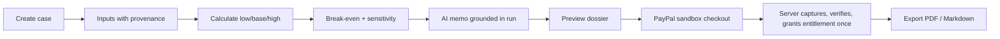

# 21 — Hackathon and Product Demo Script

Related: [01](01-executive-summary.md), [08](08-event-schema-and-payment-lifecycle.md), [17](17-implementation-roadmap.md). **Hackathon rules, deadlines, and judging criteria were not provided and are not assumed (OPEN).**

## 0. Implemented vs planned (update before every demo)

| Capability | Status as of 2026-11-03 |
|---|---|
| Everything below | **PLANNED — nothing implemented** |

Maintain this table at demo time, pulling truth from `docs/DESIGN.md`. Use exactly these labels in speaker notes: **LIVE** (runs now), **SANDBOX** (real flow, sandbox PayPal), **FIXTURE** (pre-seeded/synthetic), **PLANNED** (slide only). Never narrate PLANNED items as working.

Minimum viable demo slice (roadmap): STEP-001…021 + 022, with payments from STEP-024…028 if time allows (capture is STEP-026, webhooks STEP-027). The calculation-and-memo story still demonstrates the core differentiator without billing.

## 1. Demo narrative (3–5 minutes)

1. **Problem (30 s):** "Authors and small publishers decide whether to produce a title using unlabelled spreadsheet guesses."
2. **Idea (20 s):** "Nimphy turns a title idea into a transparent business case: numbers from a deterministic engine, explanations from AI that is not allowed to invent numbers."
3. **Walkthrough (2–3 min)** below.
4. **Architecture (45 s)** below.
5. **Honesty slide (20 s):** validation verdict is *validate further*; no customers yet; scenarios are illustrative.

## 2. End-to-end workflow

## 3. Product walkthrough script

| Step | Say | Show | Label (at time of writing) |
|---|---|---|---|
| 1 | "A fictional paperback with synthetic costs." | New case, input form; mark list price `user_input`, unit cost `estimate`, one quote with evidence | PLANNED |
| 2 | "Every number carries provenance." | Provenance badges, missing-evidence list | PLANNED |
| 3 | "Calculate." | Low/base/high, break-even, sensitivity ranking | PLANNED |
| 4 | "Rule pack version is recorded." | Rule chip with version + engine version (synthetic `TEST_*` pack, **say so**) | PLANNED |
| 5 | "Open the trace." | Trace viewer from an output to its inputs | PLANNED |
| 6 | "Now the AI." | Memo with number tokens resolved; uncertainty section | PLANNED |
| 7 | "Buy the dossier." | Preview → PayPal **sandbox** | PLANNED |
| 8 | "The browser only asks the server to capture; access appears only after the server validates PayPal's result." | Return page calls capture, "Confirming payment…" if unresolved → export enabled; the verified webhook arrives afterwards and is a no-op (`ALREADY_APPLIED`) | PLANNED |
| 9 | "Export." | PDF and Markdown | PLANNED |

## 4. Technical architecture explanation (45 s)

Show doc 04 container diagram: thin handlers → use-cases → pure engine / rules / AI port / documents / payments → Postgres. Three sentences: (1) money logic is pure and versioned; (2) AI cannot write numbers, a validator enforces it; (3) payment proof comes only from server-side, authenticated PayPal facts funnelled through one settlement function, never from the browser.

## 5. PayPal sandbox flow

Prepared sandbox buyer and merchant accounts; webhook id configured for the demo environment; public HTTPS URL for webhooks or a recorded-replay fallback (**OPEN**: tunnelling tool). Narrate: redirect back ≠ paid; the return page asks the server to capture; entitlement appears only after the server validates PayPal's result (own capture response, verified webhook, or own read); the late webhook is recorded as already applied. Never show live credentials; never use real cards.

## 6. AI explanation demonstration

Show the memo beside the numbers; point out that figures are substituted from the run. Optional "tamper" demo: show validator rejecting a deliberately altered fake-provider output containing an invented number (uses fake adapter — say so).

## 7. Deterministic calculation demonstration

Change one input → new Case Revision → new run with different hash; revert → identical `results_hash` to the earlier run. Show the golden-test suite passing (terminal) if available.

## 8. Failure scenarios (rehearse)

| Scenario | Expected | Notes |
|---|---|---|
| AI provider off (kill switch) | Numbers visible, memo unavailable message | Uses real kill switch once built |
| Forged webhook replay | 400, no entitlement | Scripted request |
| Duplicate webhook | One entitlement | Replay same event |
| Webhook delayed | "Confirming" persists; reconciliation recovers | Run reconcile |
| Webhook processing fails once, PayPal redelivers | Event shows `FAILED_RETRYABLE`, then `PROCESSED`; one entitlement | Inject a failure, replay the same event |
| Delete a case with a paid dossier | Needs paid-loss acknowledgement; case vanishes at once; order retained without personal content | Show doc 06 §8 result |
| Missing evidence | Explicit gaps in UI and memo | Seed case |

## 9. Preparation checklist

- [ ] Update §0 table from `docs/DESIGN.md`.
- [ ] Seed synthetic demo data; confirm no real person/book data.
- [ ] Sandbox accounts, webhook, and replay fallback tested the day before.
- [ ] AI provider key/budget available, or fake provider fixtures loaded.
- [ ] Backup recording of the full flow.
- [ ] Rule pack shown is labelled synthetic.
- [ ] Disclaimer visible on screens used.
- [ ] Browser zoom and a11y of demo screens checked.
- [ ] Rehearsed failure scenarios.

## 10. Known limitations (state them)

No validated demand; no customers; scenarios illustrative; rule packs synthetic until sourced; limited marketplaces/formats; single currency per case; no market-demand scoring, data licences, keyword research, sales import, tracking, teams, or subscriptions (excluded by design); legal/tax/privacy review not done; PayPal live mode not enabled.
